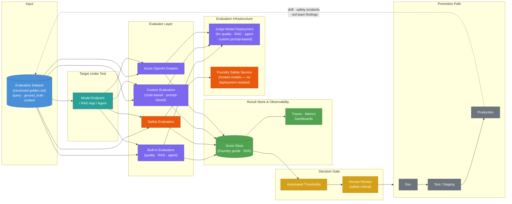
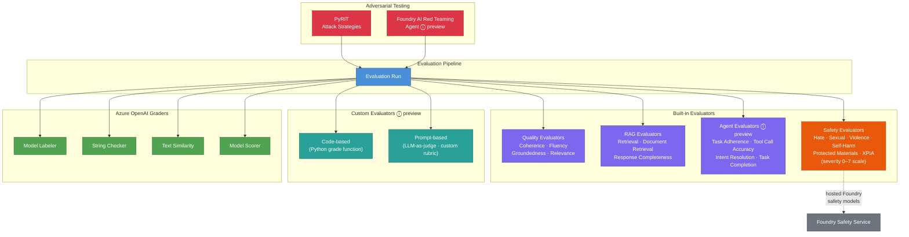

# Building AI Evaluation Pipelines on Azure

> Part 1 of a series on AI evaluation pipelines for the Azure Architecture Center (AI & ML section). Start with the [strategy guide for technical leaders](../00-strategy-guide-caf/ai-eval-strategy-guide.md) if you're designing your organization's evaluation approach.

Shipping an AI application that works in a demo is easy. Shipping one that's reliable, grounded, and safe across thousands of real-world interactions is a different problem entirely. This article introduces the evaluation pipeline — the architectural pattern that bridges that gap. We walk through a reference architecture, a decision framework for choosing the right evaluation types, the tooling available in [Microsoft Foundry](https://learn.microsoft.com/en-us/azure/foundry/), and practical guidance for structuring evaluations across development, test, and production environments. No code in this article — the follow-on deep dives cover implementation.

## Introduction

### What is an AI evaluation pipeline and why you need one

An AI evaluation pipeline is a systematic, repeatable process that scores your AI application's outputs against defined quality, safety, and task-completion criteria. It takes evaluation datasets as input, runs your application (or model) against them, applies a battery of evaluators, and produces quantitative scores that feed into deployment decisions.

If you've built traditional software, you already run tests in CI/CD before shipping. AI evaluation pipelines serve an analogous role, but for a fundamentally different kind of output. Your model doesn't return `true` or `false` — it returns natural language, tool calls, or multi-step reasoning chains. You need specialized scoring to assess whether those outputs are *good enough*.

### The gap between "works in a notebook" and "safe to ship"

Most teams start AI development in a notebook. You try a few prompts, eyeball the responses, maybe show them to a colleague. That's fine for exploration, but it tells you almost nothing about how your application behaves at scale. A handful of cherry-picked examples won't surface the edge cases where your RAG system hallucinates, your agent calls the wrong tool, or your model generates harmful content in response to an adversarial input.

The evaluation pipeline closes this gap. It moves quality assessment from *ad hoc and subjective* to *systematic and quantifiable*. Instead of "it looked good when I tried it," you get "groundedness scored 4.2/5 across 500 test cases, with 3 flagged safety incidents."

### Evaluation vs. testing

Evaluation pipelines complement traditional software testing — they don't replace it. Your unit tests, integration tests, and end-to-end tests still matter. They verify deterministic behavior: does the API return a 200? Does the retrieval service connect to the right index? Does the authentication middleware reject expired tokens?

Evaluations operate in a different space. They assess the *probabilistic, subjective quality* of AI outputs using scoring rubrics and statistical analysis. A groundedness evaluator doesn't check whether a response *is* grounded — it scores *how well* grounded it is on a scale. A safety evaluator doesn't return pass/fail — it returns a severity score from 0 to 7. You set thresholds on these scores and treat them as deployment gates, but the underlying measurement is fundamentally different from `assertEquals`.

Both layers are necessary. Traditional tests catch infrastructure and integration regressions. Evaluations catch quality degradation, hallucination, safety violations, and behavioral drift.

## Reference architecture: evaluation pipeline

The following diagram shows the end-to-end architecture of an AI evaluation pipeline. Every component is discussed in the sections that follow.

### Evaluation dataset

Golden datasets are curated, version-controlled collections of queries, expected responses, and context that represent your application's real-world usage patterns. A good golden dataset isn't just "a bunch of questions" — it's stratified across your application's domains, difficulty levels, and edge cases.

Version your datasets alongside your code. When you change your prompt template or swap a retrieval strategy, you need to know whether quality changed *relative to the same inputs*. Unversioned datasets make that comparison meaningless.

Representative data matters. If your production traffic is 60% customer-support queries and 40% product questions, your evaluation dataset should reflect that distribution. Skewing toward easy cases gives you flattering scores that don't predict real-world performance.

### Target under test

The target is whatever you're evaluating: a standalone model endpoint, a RAG application (retrieval + generation), or an agent (multi-step reasoning with tool calls). The evaluation pipeline treats it as a black box — send input, capture output.

This abstraction is deliberate. You should be able to swap the underlying model, change your retrieval index, or refactor your agent's tool definitions, then re-run the same evaluation suite to measure the impact.

### Evaluator layer

Evaluators are the scoring functions that assess your target's outputs. Microsoft Foundry provides three categories:

- **Built-in evaluators** cover quality (coherence, fluency, relevance), RAG-specific metrics (groundedness, retrieval quality), agent metrics (task adherence, tool call accuracy), and safety (content risks, protected materials). There are [30+ built-in evaluators](https://learn.microsoft.com/en-us/azure/foundry/concepts/built-in-evaluators) available.
- **Custom evaluators** let you define your own scoring logic — either as a Python function (code-based) or as an LLM-as-judge with a custom rubric (prompt-based). See [custom evaluators](https://learn.microsoft.com/en-us/azure/foundry/concepts/evaluation-evaluators/custom-evaluators).
- **Azure OpenAI graders** — Model Labeler, String Checker, Text Similarity, and Model Scorer — provide flexible assessment primitives for cases where built-in evaluators don't fit.

You typically compose a *stack* of evaluators for each evaluation run. A RAG application might run groundedness + relevance + retrieval quality + content safety in a single pass.

### Result store and observability

Evaluation scores land in the [Foundry portal](https://learn.microsoft.com/en-us/azure/foundry/), where you can view results over time, compare runs, and drill into individual examples. You can also access results programmatically through the SDK for custom dashboards or alerting.

[Observability](https://learn.microsoft.com/en-us/azure/foundry/concepts/observability) extends beyond evaluation scores. Foundry captures traces across your application's inference pipeline — retrieval latencies, token usage, tool call sequences — so you can correlate quality scores with operational metrics.

### Decision gate

Not every deployment decision should be fully automated. Decision gates combine automated threshold checks with optional human review:

- **Automated thresholds** check quantitative criteria: "defect rate = 0% at safety threshold ≥ 3", "average groundedness > 4.0", "Retrieval pass rate ≥ 90%." If any threshold fails, the pipeline blocks promotion. Safety thresholds should be risk-tiered: the Foundry default threshold of 3 (on the 0–7 severity scale) is appropriate for most external-facing applications; internal tools may tolerate a threshold of 4, but document the rationale.
- **Human review** is essential for safety-critical applications. Even when automated safety evaluators pass, some organizations require a human sign-off before promoting to production. This is a policy decision, not a technical limitation.

Design your gates to be explicit and auditable. Every promotion should have a record of which evaluations ran, what scores were produced, and who (or what) approved the move.

### Promotion path

Artifacts move from development through test to production. At each boundary, a different evaluation suite runs with different rigor:

- **Dev → Test**: Quality evaluations pass minimum thresholds; no critical safety flags.
- **Test → Production**: Full evaluator suite passes; safety evaluations clear; statistical confidence met; human review complete (if required).

### Where evaluations run

You have two execution modes:

- **Cloud evaluations (preview)** via the [Foundry evaluation service](https://learn.microsoft.com/en-us/azure/foundry/how-to/develop/cloud-evaluation) — scalable, managed, and the preferred pattern for CI/CD integration and team collaboration. Results are stored centrally in your Foundry project. Cloud evaluations are currently in preview — evaluate their readiness for your production gates accordingly, and plan a fallback posture (scheduled offline evaluations + observability) until the feature reaches general availability.
- **Local evaluations** via the [`azure-ai-evaluation` SDK](https://learn.microsoft.com/en-us/azure/foundry/how-to/develop/cloud-evaluation) — runs on your machine or in a CI runner. Useful for rapid development iteration and as a production-grade CI/CD option today, since this package is generally available.

Both modes use the same evaluator definitions, so you can develop locally and promote to cloud evaluations without rewriting anything.

### Security and governance

Foundry project scoping controls who can run evaluations, view results, and modify evaluation configurations. Use Azure RBAC to restrict access — not everyone on the team needs to configure safety evaluators or approve production gates.

Safety evaluators have regional availability requirements. They run on hosted Foundry safety models, not your own deployments, and are available in specific Azure regions. Check the [documentation](https://learn.microsoft.com/en-us/azure/foundry/concepts/evaluation-evaluators/risk-safety-evaluators) for current region support before designing your pipeline topology.

## Evaluation types: a decision framework

Choosing the right evaluators isn't about running everything every time. It's about matching evaluation types to the failure modes that matter for your application, at the pipeline stage where they're most effective.

The table below frames each evaluation type as a *failure detector*: what breaks, what catches it, and where in the pipeline it belongs.

| Eval type | Primary failure mode | Key evaluators | Best stage | Typical gate |
|---|---|---|---|---|
| **Model / quality** | Incoherent, off-topic, or poorly grounded responses | Coherence, Fluency, Groundedness, Relevance | Dev + Test | Avg. quality score ≥ 4.0/5 |
| **RAG** | Retrieval failures, hallucination from poor grounding | Retrieval Score, Document Retrieval, Groundedness, Relevance, Response Completeness | Dev + Test | Groundedness ≥ 4.0; Retrieval pass rate ≥ 90% |
| **Agent** | Misunderstood intent, wrong tool calls, incomplete tasks | Task Adherence, Tool Call Accuracy, Intent Resolution, Task Completion, Tool Selection | Test + Prod (continuous) | Task completion ≥ 90%; tool accuracy ≥ 95% |
| **Safety** | Harmful, biased, or policy-violating content | Hate/Unfairness, Sexual, Violence, Self-Harm, Protected Materials, Code Vulnerability, Ungrounded Attributes, Indirect Attack (XPIA), Prohibited Actions, Sensitive Data Leakage | ALL stages | Defect rate = 0% at default threshold (severity ≥ 3 on the 0–7 scale); tighten for external-facing apps |
| **Red teaming** | Vulnerabilities that standard evaluations miss — prompt injection, jailbreaks, content policy bypasses | Adversarial probing via PyRIT attack strategies and/or Foundry AI Red Teaming Agent | Pre-deployment + periodic | No critical vulnerabilities; documented mitigations for medium-risk findings |

> [!NOTE]
> **Preview features:** [Agent evaluators](https://learn.microsoft.com/en-us/azure/foundry/concepts/evaluation-evaluators/agent-evaluators) and the [AI Red Teaming Agent](https://learn.microsoft.com/en-us/azure/foundry/concepts/ai-red-teaming-agent) are currently in preview. Evaluate their suitability for your production gates accordingly.

**What each type doesn't catch:**
- Quality evaluations don't catch safety violations — a fluent, coherent response can still be harmful.
- RAG evaluations don't assess whether your retrieval index is *complete* — they assess whether retrieved documents support the generated response.
- Agent evaluations don't catch safety issues in tool outputs — pair with safety evaluators.
- Safety evaluators don't measure quality — a safe response can still be unhelpful or wrong.
- Red teaming finds vulnerabilities but doesn't quantify baseline quality — it's a probe, not a benchmark.

### Recommended evaluator stacks by application type

Don't build your evaluator stack from scratch every time. Start with these baseline recommendations:

**RAG applications:**
- Retrieval Score + Groundedness + Relevance + Content Safety evaluators
- Add Response Completeness if answer thoroughness matters for your use case

**Agent applications:**
- Tool Call Accuracy + Task Adherence + Intent Resolution + Content Safety evaluators
- Add Task Completion for end-to-end workflow validation

**All applications:**
- Always include [risk and safety evaluators](https://learn.microsoft.com/en-us/azure/foundry/concepts/evaluation-evaluators/risk-safety-evaluators). There is no application type where skipping safety evaluation is acceptable.

### Foundry evaluation ecosystem

The following diagram shows how the different evaluator categories relate to each other and to the evaluation pipeline.

## Microsoft Foundry evaluation tooling

This section gives you a map of what's available. The deep-dive articles in this series cover implementation details.

### Built-in evaluators

Microsoft Foundry provides [30+ built-in evaluators](https://learn.microsoft.com/en-us/azure/foundry/concepts/built-in-evaluators) spanning quality, RAG, agent, safety, and textual similarity categories. These are production-ready, maintained evaluators that cover the most common assessment needs. You configure them with your evaluation dataset and target, and they return structured scores.

Quality evaluators (coherence, fluency, groundedness, relevance) are the baseline — run them on every AI application. RAG evaluators add retrieval-specific metrics. [Agent evaluators](https://learn.microsoft.com/en-us/azure/foundry/concepts/evaluation-evaluators/agent-evaluators) (preview) assess multi-step reasoning and tool use. [Safety evaluators](https://learn.microsoft.com/en-us/azure/foundry/concepts/evaluation-evaluators/risk-safety-evaluators) use hosted Foundry safety models to score content risks on a 0–7 severity scale.

### Custom evaluators (preview)

When built-in evaluators don't cover your domain-specific quality criteria, [custom evaluators](https://learn.microsoft.com/en-us/azure/foundry/concepts/evaluation-evaluators/custom-evaluators) let you define your own:

- **Code-based evaluators** — write a Python `grade()` function that takes the model's output and returns a score. Full flexibility, deterministic logic, no LLM cost.
- **Prompt-based evaluators** — define a rubric and let an LLM judge your model's output. Useful when quality criteria are nuanced and hard to express as code. You create these in the Foundry portal or via the SDK.

> [!NOTE]
> Custom evaluators are currently in preview.

### Azure OpenAI graders

For assessment scenarios that fall between built-in evaluators and fully custom code, Azure OpenAI graders provide composable primitives:

- **Model Labeler** — classifies outputs into categories you define.
- **String Checker** — validates outputs against exact or pattern-based expectations.
- **Text Similarity** — compares outputs to reference answers using embedding similarity.
- **Model Scorer** — scores outputs on arbitrary rubrics using a model-as-judge approach.

### Evaluation SDK

Two SDK packages serve different parts of the pipeline:

- **`azure-ai-projects` 2.x** (the Foundry SDK) — the preferred path for cloud evaluations (preview). Submit evaluation runs to the Foundry service, retrieve results programmatically, and integrate with CI/CD pipelines. Cloud evaluations give you centralized results, team collaboration, and scale. Since cloud evaluations are currently in preview, validate their stability for your specific gate requirements before depending on them for production promotion.
- **`azure-ai-evaluation`** — the generally available package for local execution and CI/CD automation. Run evaluators on your machine or in a CI runner for fast iteration during development. Also supports [Azure DevOps task integration](https://learn.microsoft.com/en-us/azure/foundry/how-to/develop/run-evaluations-azure-devops) and GitHub Actions. This is the production-grade option for automated pipeline gates today.

Cloud evaluations are the recommended direction for test and production stages as they mature toward general availability. Local evaluations via `azure-ai-evaluation` are the right choice for development iteration and serve as a reliable CI/CD path in the meantime.

## Environment guidance: dev → test → prod

Evaluation rigor should scale with deployment risk. Running your full evaluator suite on every prompt tweak during development wastes time and budget. Running only a quick quality check before shipping to production is reckless. Match your evaluation investment to the stage.

```mermaid
flowchart LR
    subgraph Dev["Development"]
        D1["Local evaluations<br/>(azure-ai-evaluation SDK)"]
        D2["Small dataset<br/>10–50 examples"]
        D3["Quality + Relevance<br/>+ safety smoke test"]
        D4["Fast iteration:<br/>run after each<br/>prompt or retrieval change"]
    end

    subgraph Test["Test / Staging"]
        T1["Cloud evaluations (preview)<br/>or local SDK in CI/CD"]
        T2["Full golden dataset<br/>100+ examples"]
        T3["Complete evaluator suite<br/>including safety"]
        T4["CI/CD integration<br/>statistical confidence<br/>automated gates"]
        T5["Human review<br/>for safety-critical<br/>decisions"]
    end

    subgraph Prod["Production"]
        P1["Continuous evaluation<br/>(agents: Foundry built-in<br/>others: custom telemetry<br/>+ scheduled offline runs)"]
        P2["Quality drift<br/>monitoring"]
        P3["Safety incident<br/>response"]
        P4["Periodic red<br/>teaming scans"]
        P5["Observability:<br/>traces · metrics<br/>Foundry dashboards"]
    end

    Dev -- "quality gate<br/>passed" --> Test
    Test -- "full gate<br/>passed +<br/>human review" --> Prod
    Prod -. "drift · safety incidents<br/>· red team findings<br/>→ new test cases" .-> Dev

    classDef dev fill:#4A90D9,stroke:#2C5F8A,color:#fff
    classDef test fill:#D4A017,stroke:#9A7412,color:#fff
    classDef prod fill:#51A351,stroke:#367336,color:#fff

    class D1,D2,D3,D4 dev
    class T1,T2,T3,T4,T5 test
    class P1,P2,P3,P4,P5 prod
```

### Development

During development, speed matters more than statistical rigor. Use the `azure-ai-evaluation` SDK to run evaluators locally. Keep your dataset small — 10 to 50 representative examples that cover your key scenarios. Focus on quality and relevance evaluators, plus a lightweight safety smoke test (run content safety evaluators on a handful of adversarial or edge-case prompts). Run evaluations after each significant prompt or retrieval change.

The goal at this stage is *rapid signal*: is this change making things better or worse? You're not looking for statistical confidence — you're looking for directional feedback. If groundedness drops from 4.3 to 3.1 after a prompt change, you know something went wrong without needing 500 test cases to prove it.

### Test / staging

This is where rigor kicks in. Switch to [cloud evaluations via the Foundry SDK](https://learn.microsoft.com/en-us/azure/foundry/how-to/develop/cloud-evaluation) (preview) for centralized results and scale, or run the full evaluator suite locally via `azure-ai-evaluation` in your CI/CD pipeline if you need a generally available path. Run your full golden dataset — 100 or more examples, stratified across your application's domains.

Deploy the complete evaluator suite, including safety evaluators. Integrate evaluations into your CI/CD pipeline using the [Azure DevOps evaluation task](https://learn.microsoft.com/en-us/azure/foundry/how-to/develop/run-evaluations-azure-devops) or a GitHub Action. Compute statistical confidence intervals on your scores — with a large enough dataset, you can detect meaningful quality regressions versus noise.

Define automated gates with explicit thresholds. When a gate fails, the pipeline blocks promotion. For safety-critical applications, add a human review step even when automated gates pass. Document the gate criteria so they're auditable.

### Production

Deployment isn't the finish line. For agent applications, [continuous evaluation](https://learn.microsoft.com/en-us/azure/foundry/how-to/develop/continuous-evaluation) runs evaluators against sampled agent responses in production to detect quality drift, emerging safety issues, and behavioral changes that your golden dataset didn't anticipate. For non-agent workloads (model endpoints, RAG applications), continuous evaluation requires custom telemetry pipelines that sample production traffic and feed it into scheduled offline evaluation runs.

Monitor quality scores over time. A gradual decline in groundedness or relevance can indicate that your retrieval index is stale, your model's behavior has shifted, or your user population's query patterns have changed. Set alerting thresholds so you catch drift before users notice.

Build an incident response process for safety evaluator flags in production. When a safety evaluator scores a response at or above the severity threshold (default 3 on the 0–7 scale), you need a clear escalation path.

Schedule periodic [red teaming](https://learn.microsoft.com/en-us/azure/foundry/concepts/ai-red-teaming-agent) scans. The threat landscape evolves — new jailbreak techniques, new adversarial strategies. Adversarial testing shouldn't be a one-time pre-launch activity. Use [PyRIT](https://github.com/Azure/PyRIT) attack strategies and/or the Foundry AI Red Teaming Agent (preview) on a regular cadence.

### Closing the loop: production findings → golden dataset

An evaluation pipeline isn't a one-direction flow. When production monitoring surfaces quality drift, safety incidents, or red-team findings, those findings should feed back into your evaluation dataset as new test cases. This closed-loop pattern ensures your golden dataset evolves with your application's real-world exposure. A groundedness failure caught in production becomes a regression test. An adversarial prompt discovered during red teaming becomes a safety smoke-test case. Without this feedback path, your evaluation suite grows stale and loses its predictive value over time.

Integrate with [Foundry observability](https://learn.microsoft.com/en-us/azure/foundry/concepts/observability) for traces, metrics, and dashboards that give you end-to-end visibility into your application's behavior.

## Where to go next

This article gives you the map. The rest of this series fills in the details:

- **[AI Evaluation Strategy for Technical Leaders](../00-strategy-guide-caf/ai-eval-strategy-guide.md)** — strategic context, governance considerations, and adoption roadmap for leaders designing their organization's evaluation approach
- **Building AI evaluation pipelines on Azure** — overview and foundations (this article)
- **[Reference Architecture for Agent Evaluation](../02-ref-architecture/ai-eval-ref-architecture.md)** — end-to-end implementation with Python code, Bicep infrastructure, GitHub Actions CI/CD, and sample datasets
- **Quality and RAG evaluators** *(coming soon)* — SDK deep-dive into quality and retrieval evaluation, including dataset design and threshold tuning
- **Agent evaluators** *(coming soon)* — evaluating multi-step reasoning, tool use, and task completion
- **Safety evaluations** *(coming soon)* — implementing content safety evaluators, severity scoring, and safety gates
- **Red teaming with PyRIT and the Foundry AI Red Teaming Agent** *(coming soon)* — adversarial testing strategies and automation
- **[Deploying Microsoft Foundry Agents — A Leader's Guide](../07-deploy-foundry-agents/foundry-agents-deployment.md)** — strategic guidance on agent type selection and private-network deployment shape for the Foundry Agent Service that hosts what these pipelines evaluate

### Additional resources

- [Microsoft Foundry documentation](https://learn.microsoft.com/en-us/azure/foundry/)
- [Built-in evaluators reference](https://learn.microsoft.com/en-us/azure/foundry/concepts/built-in-evaluators)
- [Risk and safety evaluators](https://learn.microsoft.com/en-us/azure/foundry/concepts/evaluation-evaluators/risk-safety-evaluators)
- [Agent evaluators](https://learn.microsoft.com/en-us/azure/foundry/concepts/evaluation-evaluators/agent-evaluators)
- [Custom evaluators](https://learn.microsoft.com/en-us/azure/foundry/concepts/evaluation-evaluators/custom-evaluators)
- [Cloud evaluations (SDK)](https://learn.microsoft.com/en-us/azure/foundry/how-to/develop/cloud-evaluation)
- [Continuous evaluation](https://learn.microsoft.com/en-us/azure/foundry/how-to/develop/continuous-evaluation)
- [AI Red Teaming Agent](https://learn.microsoft.com/en-us/azure/foundry/concepts/ai-red-teaming-agent)
- [Observability in generative AI applications](https://learn.microsoft.com/en-us/azure/foundry/concepts/observability)
- [Run evaluations in Azure DevOps](https://learn.microsoft.com/en-us/azure/foundry/how-to/develop/run-evaluations-azure-devops)
- [PyRIT — Python Risk Identification Tool](https://github.com/Azure/PyRIT)
