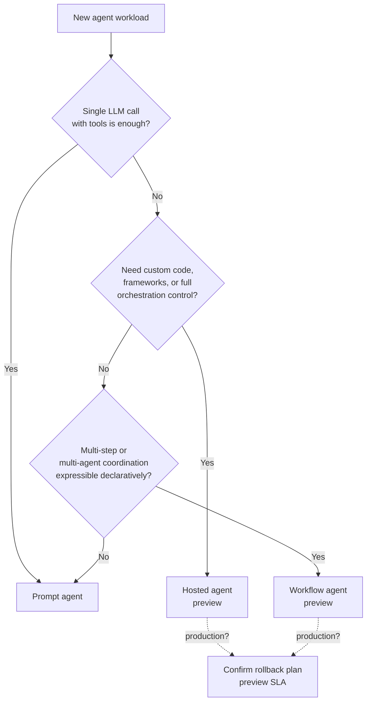
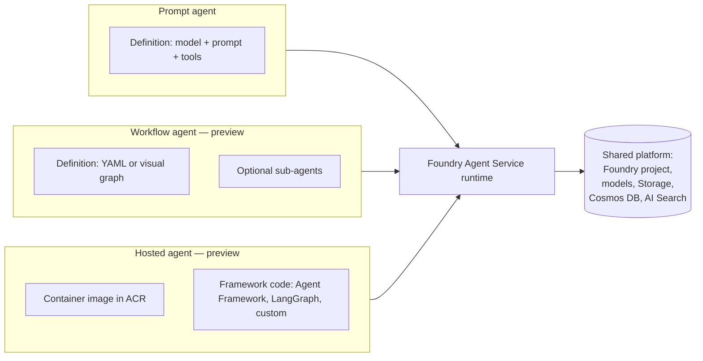
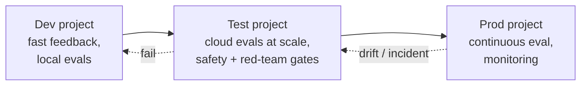
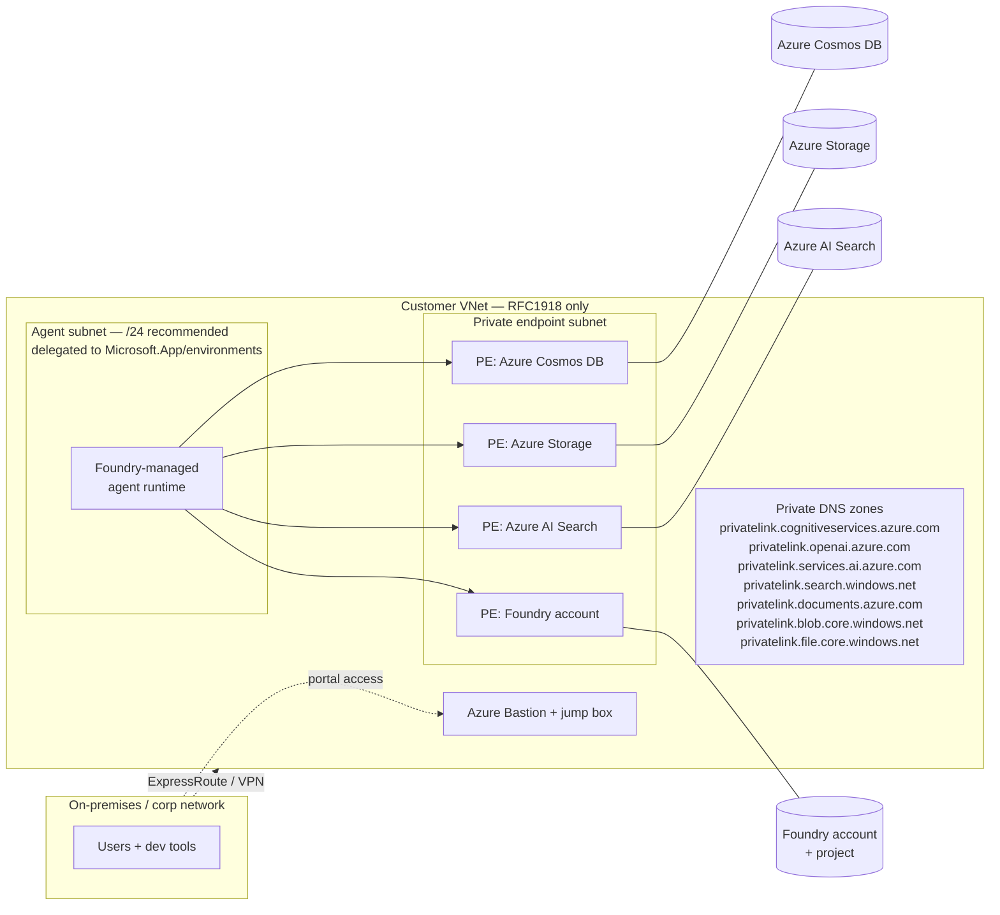
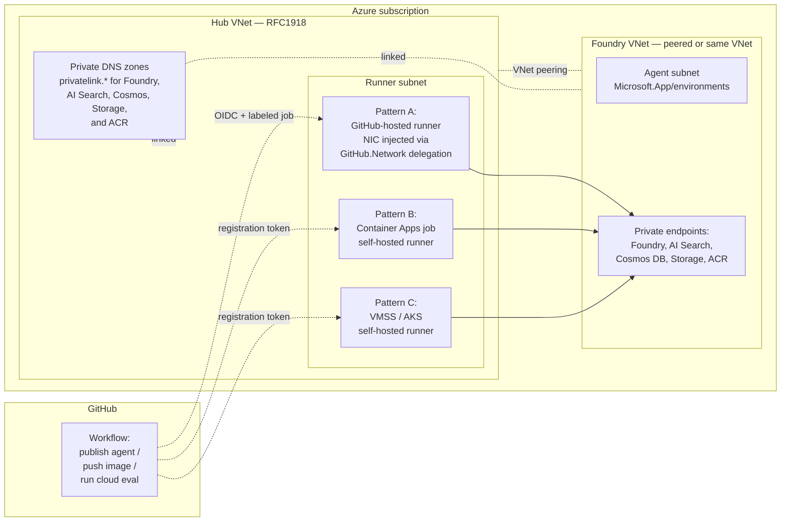

# Deploying Microsoft Foundry Agents — A Leader's Guide

> Part of a series on AI evaluation and platform decisions for Microsoft Foundry on Azure.
> Audience: solution architects, cloud architects, platform leads, and IT decision makers.
> No code samples — this is strategic guidance for shaping the deployment, not a build tutorial.

## TL;DR

- **Microsoft Foundry Agent Service** supports three agent types — **prompt agents**
  (GA, declarative), **workflow agents** (preview, declarative orchestration), and
  **hosted agents** (preview, code-in-containers). Each has a different code, hosting,
  and ownership profile.
- All three sit on the same shared platform: a Foundry account and project, model
  deployments, plus Azure Storage, Azure Cosmos DB, and Azure AI Search for state and
  retrieval. Choose region, subscription, and network shape **before** picking an agent
  type — those decisions constrain everything that follows.
- **Private networking is the highest-leverage decision.** The "Standard Setup with
  private networking" pattern injects an agent subnet into your VNet (delegated to
  `Microsoft.App/environments`) and locks all dependent resources behind private
  endpoints, but it can only be deployed via Bicep or Terraform and it carries a
  specific set of constraints (RFC1918-only subnets, single region for everything,
  subnet exclusivity, restricted Bing regions, and more).
- Treat **workflow** and **hosted** agents as preview when you make production
  commitments. Build a rollback path that falls back to prompt agents or to a
  framework-only deployment outside Foundry.
- A private Foundry **breaks default GitHub-hosted CI/CD**. Plan the runner topology
  alongside the network topology — VNet-injected GitHub-hosted runners (GHEC),
  self-hosted runners on Azure Container Apps jobs, or self-hosted runners on
  VMs/AKS — and use OIDC federation, not secrets, for the workflow identity.

## 1. Introduction

### What "deploying a Foundry agent" actually means

A Foundry agent is not a single binary you ship to a VM or a container app. It is a
**managed runtime** that combines four things:

1. A **model** deployment (Azure OpenAI or another model from the Foundry catalog).
2. **Instructions** — a prompt, a declarative workflow definition, or your own code.
3. **Tools** — connectors to data and actions (search indexes, file stores, APIs,
   grounding services).
4. **State** — threads, messages, files, and vector data backed by **your** Storage,
   Cosmos DB, and AI Search resources.

Foundry Agent Service handles hosting, scaling, identity, observability, and the
control plane. You bring the data resources, choose the network shape, and decide which
agent type fits each workload. From an operations standpoint, "deploying" an agent
means **provisioning the platform once** and then publishing agent definitions or
container images into it.

### Why this is a leadership concern

The decisions that are hardest to reverse are made before any agent ships:

- **Region** — drives data residency, model availability, and which tools you can use
  (Grounding with Bing Search has a restricted region list, for example).
- **Subscription and project topology** — determines blast radius, RBAC complexity, and
  cost attribution.
- **Network model** — public, service-endpoint, or fully private with BYO VNet. The
  private model is the only one with no public egress, but it is also the most
  constrained at deploy time.
- **Preview-feature exposure** — workflow and hosted agents are in preview. Standing up
  a production workload on them is a deliberate risk choice with a rollback plan.

The rest of this article walks through these decisions in the order you should make them.

## 2. The three Foundry agent types

Foundry Agent Service supports three agent types. They are not tiers — they are
different shapes for different problems.

### Prompt agents (GA)

A prompt agent is a **declarative single agent**: a model, a system prompt, and a set
of attached tools. You author it in the Foundry portal or via the API/SDK, version it,
publish it, and invoke it. There is no container to build and no orchestration code to
maintain. Foundry runs everything.

**Best for:** rapid prototyping, internal productivity tools, single-task assistants,
RAG over a small set of indexes, and anywhere a single LLM call (with tool use) is
sufficient.

### Workflow agents (preview)

A workflow agent **orchestrates a sequence of actions or coordinates multiple agents**
through a declarative definition. You can author workflows visually in the Foundry
portal or in YAML through Visual Studio Code. Workflows support branching logic,
human-in-the-loop steps, and sequential or group-chat patterns.

**Best for:** multi-step automation, agent-to-agent coordination, approval workflows,
and repeatable processes that do not justify writing custom orchestration code.

> **Preview.** Treat workflow agents as preview for production commitments. SLA, API
> stability, and feature surface may change.

### Hosted agents (preview)

A hosted agent is **your code, packaged as a container, run by Foundry Agent Service.**
You build the agent with the framework of your choice (Microsoft Agent Framework,
LangGraph, Semantic Kernel, or custom code), push the image to Azure Container
Registry, and deploy it through the Visual Studio Code Foundry extension or the
Foundry `azd` template. Foundry handles the runtime, scaling, identity, and the
inbound API surface; you own the image, the dependencies, the orchestration logic,
and the observability hooks inside your code.

**Best for:** complex multi-step orchestration, custom tool integrations, multi-agent
systems that need code-level control, and teams that already have framework expertise
and want managed hosting rather than running their own AKS or Container Apps.

> **Preview.** Same caveat as workflow agents — plan a fallback path.

### Comparison

|                    | Prompt agents       | Workflow agents (preview) | Hosted agents (preview)        |
|--------------------|---------------------|---------------------------|--------------------------------|
| Code required      | No                  | No (YAML optional)        | Yes                            |
| Hosting            | Fully managed       | Fully managed             | Container, managed by Foundry  |
| Orchestration      | Single agent        | Multi-agent, branching    | Custom logic, your framework   |
| Author surface     | Portal, SDK, REST   | Portal, YAML in VS Code   | VS Code extension, `azd`       |
| Customer owns      | Definition + tools  | Definition + tools        | Image, code, deps, telemetry   |
| Best for           | Prototypes, simple  | Multi-step automation     | Custom logic, framework users  |
| GA status          | GA                  | Preview                   | Preview                        |

### Decision flow

Use the diagram as a starter, not a rule. A workload that "almost fits" a prompt agent
but needs one branching step is often better as a prompt agent plus an external trigger
than as a preview workflow agent — keep complexity proportional to the problem.

## 3. Deployment models per agent type

All three agent types share the same platform footprint. What changes is **what you
ship** into it.

### Shared platform footprint

| Resource | Purpose | Owned by |
|----------|---------|----------|
| Foundry account + project | Control plane, agent definitions, identities | Customer |
| Model deployments (Azure OpenAI / Foundry catalog) | Reasoning | Customer |
| Azure Storage | Files, attachments | Customer (BYO in private setup) |
| Azure Cosmos DB | Threads, messages, agent state | Customer (BYO in private setup) |
| Azure AI Search | Vector store / retrieval | Customer (BYO in private setup) |
| Log Analytics workspace | Logs and telemetry | Customer |
| Azure Container Registry | Hosted-agent images | Customer (hosted agents only) |
| Agent runtime (compute) | Executes agents | Microsoft-managed |

### What you ship per agent type

### Lifecycle, in one paragraph

For all three: **author → version → publish → invoke → evaluate → monitor → re-publish.**
Prompt and workflow agents are versioned through the Foundry control plane. Hosted
agents are versioned through their container image tag, with a deploy step that
registers the new version with Foundry. Evaluation gates from the rest of this series
(see the
[pipeline overview](../01-pipeline-overview/ai-eval-pipeline-overview.md))
sit between **publish** and **promote-to-prod**, regardless of agent type.

## 4. Environments and lifecycle

### Two patterns for dev / test / prod

**Project-per-environment (lightweight).** One Foundry account, separate projects for
dev, test, and prod. Cheaper, simpler RBAC, but a misconfiguration can leak across
environments through shared account-level settings.

**Resource-per-environment (recommended for regulated workloads).** Separate Foundry
accounts and supporting data resources per environment, often in separate
subscriptions. Higher cost and more IaC, but full blast-radius isolation, easier audit
boundaries, and independent network postures (e.g., public dev, private prod).

For private-network deployments, **resource-per-environment is effectively forced** —
the agent subnet is exclusive to a single Foundry resource (see §5).

### Promotion path with evaluation gates

The evaluation series in this repo describes what runs at each gate. From a deployment
perspective, the key point is that **the agent type does not change the gate** — a
prompt, workflow, or hosted agent all flow through the same dev → test → prod
progression and the same evaluator suites.

## 5. Private networking for Foundry Agent Service

This is the headline section. **Private networking is the most consequential
deployment decision** for any regulated, internal-only, or data-sensitive workload —
and it is the most constrained.

### Why network isolation matters

The default deployment model exposes Foundry, Storage, Cosmos DB, and AI Search
through public endpoints (locked down by keys and RBAC). For any workload that touches
regulated data or that must demonstrate **deny-by-default egress**, that is not
sufficient. The "Standard Setup with private networking" pattern moves the entire
platform behind your VNet so that:

- Inbound traffic to Foundry and the dependent data resources flows only through
  **private endpoints** in your subnet.
- The agent runtime executes in a **subnet you own**, injected into your VNet through
  delegation to `Microsoft.App/environments`.
- Public network access is **disabled by default** on Foundry, Storage, Cosmos DB, and
  AI Search.

### Reference topology

### What the Standard Setup provisions

When you deploy the Standard Setup with private networking template (Bicep or
Terraform), it provisions — unless you bring your own:

- A VNet (e.g., `192.168.0.0/16`).
- An **agent subnet** (e.g., `192.168.0.0/24`) delegated to
  `Microsoft.App/environments`.
- A **private endpoint subnet** (e.g., `192.168.1.0/24`).
- A Foundry account, Foundry project, and a model deployment.
- Azure Storage, Azure Cosmos DB, and Azure AI Search, connected to the project.
- Private endpoints for Foundry, AI Search, Storage, and Cosmos DB.
- The required private DNS zones, linked to the VNet.
- Microsoft-managed encryption keys for Storage and the Foundry account.

You can also bring your own VNet, subnets, and any of the data resources — at the cost
of more configuration and the need to satisfy all of the constraints below.

### Known limitations — design inputs, not footnotes

Treat each of these as a **decision input** before you commit to the private-networking
shape. They are sourced from the current Microsoft Learn guidance and they change;
re-verify the
[Set up private networking for Foundry Agent Service](https://learn.microsoft.com/azure/ai-foundry/agents/how-to/virtual-networks)
page just before you deploy.

- **Programmatic deployment only.** There is no Azure portal path. You must use Bicep
  or Terraform from the official Foundry samples repository. Plan for IaC ownership
  from day one.
- **RFC1918 subnets only.** Both the agent subnet and the private endpoint subnet must
  use `10.0.0.0/8`, `172.16.0.0/12`, or `192.168.0.0/16`. Public IP ranges are
  rejected.
- **Agent subnet exclusivity.** One Foundry resource per agent subnet. You cannot
  share the agent subnet across Foundry resources, which is part of why
  resource-per-environment is the natural pattern here.
- **Subnet sizing.** The agent subnet should be **`/24` (256 addresses)** as the
  default. The minimum is **`/27` (32 addresses)** because the subnet is delegated to
  `Microsoft.App/environments`. Size for scale you expect, because resizing later is
  disruptive.
- **Region co-location.** The Foundry account, project, model deployments, Cosmos DB,
  Storage, AI Search, and the managed identity must all live in the **same region** as
  the VNet. Cross-region private setups are not supported.
- **Capability-host singletons.** The Foundry capability host accepts only **one**
  storage connection, one thread-storage (Cosmos DB) connection, and one vector-store
  (AI Search) connection. If you BYO any of them, you must BYO **all three**.
- **Tool-specific constraints:**
  - **Grounding with Bing Search** is available only in a restricted region list (West
    Europe, Canada East, Switzerland North, Spain Central, UAE North, Korea Central,
    Poland Central, Southeast Asia, West US, West US 2, West US 3, East US, East US 2,
    Central US, South India, Japan East, UK South, France Central, Norway East,
    Australia East, Canada Central, Sweden Central, South Africa North, Italy North,
    Brazil South). If you need Bing grounding **and** private networking, your region
    choice is the intersection of those two lists.
  - **File Search** does not support Azure Blob Storage files in this setup — plan an
    alternative ingestion path if Blob is your source of truth.
- **Egress firewall integration.** If Azure Firewall sits on the egress path,
  allowlist the Container Apps managed-identity FQDNs (see the
  [Container Apps + Azure Firewall](https://learn.microsoft.com/azure/container-apps/use-azure-firewall)
  guidance) or the `AzureActiveDirectory` service tag, and **disable TLS inspection**
  on those flows. Self-signed-certificate injection by the firewall is a common
  silent failure mode.
- **Resource provider registration.** Register `Microsoft.KeyVault`,
  `Microsoft.CognitiveServices`, `Microsoft.Storage`,
  `Microsoft.MachineLearningServices`, `Microsoft.Search`, `Microsoft.Network`,
  `Microsoft.App`, and `Microsoft.ContainerService` in the target subscription before
  the first deployment. Add `Microsoft.Bing` if you plan to use Grounding with Bing.
- **Teardown ordering.** When decommissioning, **purge the Foundry resource before
  deleting the VNet**. Deleting the VNet first leaves stuck
  `serviceAssociationLinks` that block re-creation in the same address space. Build
  the teardown runbook into your IaC from the start.

### How users and developers reach a private agent

Once the platform is private, every interaction with it must originate from inside the
VNet (or from a network connected to it). The supported patterns are:

- **Azure VPN Gateway** (point-to-site for individual developers, site-to-site for
  branch offices).
- **Azure ExpressRoute** for production-grade, dedicated connectivity from the
  corporate network.
- **Azure Bastion + a jump box** for ad-hoc admin access to the Foundry portal and to
  troubleshoot from inside the VNet.

Plan the access pattern at the same time as the network topology — a private platform
that nobody can reach is a common day-two problem.

## 6. CI/CD from GitHub against a private Foundry

Once Foundry sits behind a private endpoint, **standard GitHub-hosted runners can no
longer reach it.** Public runners on the GitHub network will get DNS resolution to the
public-zone records, and the deny-by-default network rules on Foundry, AI Search,
Cosmos DB, and Storage will block the connection. Any pipeline that has to publish a
prompt or workflow agent, push a hosted-agent container to ACR, or run cloud
evaluations against the project must originate from inside (or routed into) your VNet.

There are three production-grade patterns for that. They are not exclusive — most
real deployments mix them.

### Pattern A — GitHub Actions runners with Azure private networking (VNet injection)

GitHub Enterprise Cloud supports **Azure private networking for GitHub-hosted
runners**. You delegate a dedicated subnet in your Azure VNet to
`GitHub.Network/networkSettings`, register a network configuration on your GitHub
enterprise or organization, and then label runner groups against it. Jobs that target
those labels run on **GitHub-hosted runner VMs whose NIC is injected into your subnet**
for the lifetime of the job.

What you get:

- Microsoft- and GitHub-managed runner image, no patching or capacity management.
- Ephemeral runners — fresh VM per job, NIC torn down after the job.
- Direct line-of-sight to private endpoints in your VNet (Foundry, AI Search, Cosmos
  DB, Storage, ACR), subject to your NSG and private DNS configuration.
- Available for the standard Ubuntu/Windows runners and the larger SKUs (currently
  2–64 vCPU).

What to plan for:

- **GitHub Enterprise Cloud only.** Not available on Free, Pro, or Team plans.
- **Dedicated subnet** delegated to `GitHub.Network/networkSettings` — no other
  resource type may share it. This is a separate subnet from your Foundry agent
  subnet.
- **Dynamic outbound IPs** — you cannot pin static egress for downstream allowlists.
- **Region availability** is gradually expanding; verify your target region before
  committing.
- **Outbound only** — block inbound on the runner NIC at the NSG.
- **Resource provider registration:** `az provider register --namespace GitHub.Network`.
- **DNS** — link the same private DNS zones used by Foundry (the seven
  `privatelink.*` zones in §5) to the runner subnet's VNet so the runner resolves
  Foundry, AI Search, Cosmos DB, and Storage to private IPs.

This is the **lowest-ops** option and the recommended starting point for organizations
already on GitHub Enterprise Cloud.

### Pattern B — Self-hosted runners on Azure Container Apps jobs

Microsoft publishes a tutorial pattern for **event-driven, KEDA-scaled self-hosted
GitHub runners running on Azure Container Apps jobs.** Each workflow job triggers an
ephemeral container instance; the job exits when the workflow completes; the platform
scales to zero between jobs.

What you get:

- Works on any GitHub plan (no Enterprise Cloud requirement).
- Container Apps jobs already live in your VNet; they reach Foundry private endpoints
  through the same private DNS zones with no extra wiring.
- Ephemeral, scale-to-zero — close to the operational profile of GitHub-hosted runners
  but customer-managed.
- You control the runner image (preinstalled tools, Python/Node/.NET versions, AZ CLI,
  azd, evaluation SDKs) which is useful for deterministic builds.

What to plan for:

- You own the runner container image, the registration token rotation pattern, the
  KEDA scaler configuration, and patching of the base image.
- Runs in an Azure Container Apps **environment** that is itself injected into a VNet
  subnet (also delegated to `Microsoft.App/environments`). This is a **separate**
  Container Apps environment from the one Foundry uses for the agent runtime — they
  cannot share a subnet.
- Outbound egress through Azure Firewall / NAT follows the standard Container Apps
  rules.

This is the **most flexible** option and the natural fit if you already operate
Container Apps or AKS in the platform team.

### Pattern C — Self-hosted runners on VMs or AKS inside the VNet

The classic pattern: a VM Scale Set or AKS node pool running the
`actions-runner` container, registered to the org/repo, sitting in a subnet peered or
routed to the Foundry VNet.

What you get:

- Works anywhere, on any GitHub plan.
- Static egress IPs are easy (NAT gateway on the runner subnet) if downstream systems
  require allowlisting.
- Long-lived runners can cache dependencies, model artifacts, and container layers,
  which can speed up evaluation runs significantly.

What to plan for:

- You own everything: VM/AKS lifecycle, OS patching, runner upgrades (GitHub now
  enforces minimum runner versions), capacity planning, scale-to-zero (or accept idle
  cost), and the security posture of long-lived workers.
- Long-lived runners carry more risk than ephemeral ones — favor short-lived JIT
  registration patterns or treat runners as cattle with a daily reimage.

### Choosing between the three

| Concern | Pattern A — VNet-injected GitHub runners | Pattern B — Container Apps jobs | Pattern C — VM/AKS self-hosted |
|---------|------------------------------------------|---------------------------------|---------------------------------|
| GitHub plan | Enterprise Cloud only | Any | Any |
| Ops burden | Lowest (managed) | Medium (image + KEDA) | Highest (you own everything) |
| Time-to-stand-up | Hours | Days | Days–weeks |
| Static egress IP | No (dynamic) | Through NAT gateway | Through NAT gateway |
| Scale-to-zero | Yes (ephemeral per job) | Yes (event-driven) | Optional (and harder) |
| Custom toolchain in image | Limited | Full control | Full control |
| Best for | Most organizations on GHEC | Platform teams already on Container Apps | Teams with strict static-IP / heavy caching needs |

### Reference topology

### Authentication: prefer OIDC, not secrets

Whichever runner pattern you pick, the workflow itself should authenticate to Azure
with **OIDC federation through a user-assigned managed identity or a workload-identity
federation on an Entra app registration**, and use the `azure/login` action with
`auth-type: IDENTITY` (or `client-id` + `tenant-id` + `subscription-id` + the federated
credential). This avoids long-lived service principal secrets in GitHub.

For private Foundry specifically, the workflow identity needs:

- `Azure AI User` on the Foundry project (publish agents, run cloud evaluations).
- `AcrPush` on the Container Registry (hosted-agent images).
- `Reader` on the resource group (for `azd` and template lookups).

Keep these scoped to the project and registry — not to the subscription.

### Practical guidance

- **Default to Pattern A** if you are on GitHub Enterprise Cloud and your region is
  supported. The combination of managed runners, ephemeral lifecycle, and direct VNet
  reachability is the cleanest match for a private Foundry.
- **Pick Pattern B** if you need full control over the runner image (preinstalled
  evaluation SDKs, custom tooling), are not on Enterprise Cloud, or want to consolidate
  on Container Apps as the platform team's compute substrate.
- **Reserve Pattern C** for static-IP requirements, very heavy caching needs, or
  brownfield environments that already operate VM-based runners.
- **Keep the runner subnet separate** from the Foundry agent subnet in all three
  patterns — they have different delegations and different blast radii.
- **Wire the same private DNS zones** to wherever the runner lives. Most "it works
  from my laptop but the pipeline can't reach Foundry" tickets are missing or
  misaligned DNS zone links.

## 7. Security, identity, and governance

### RBAC for deploy vs. use

The roles needed to **stand up** the platform are different from the roles needed to
**use** it day to day. Define them separately so you can keep deploy permissions
narrow.

| Activity | Built-in role | Scope |
|----------|---------------|-------|
| Create Foundry account and project | **Azure AI Account Owner** | Subscription |
| Assign roles to dependent resources (Cosmos DB, Storage, AI Search) | **Role Based Access Administrator** (or **Owner**) | Subscription |
| Build, edit, publish agents from portal or SDK | **Azure AI User** | Foundry project |
| Invoke deployed agents from applications | **Azure AI User** (read + action on `agents/*`) | Foundry project |

For hosted agents, the build pipeline also needs `AcrPush` on the Container Registry
and `Azure AI User` on the project to register new versions.

### Managed identity and data-plane access

In the private-network setup, the Foundry runtime uses its **managed identity** to
reach BYO Storage, Cosmos DB, and AI Search through their private endpoints. There
should be **no shared keys or connection strings** in your agent definitions. Verify
that Storage account-key access and Cosmos DB key-based auth are disabled (or at
least unused) on the dependent resources.

### Observability and audit

Plan for:

- **Foundry observability** — built-in tracing and evaluation telemetry tied to the
  project.
- **Log Analytics** — destination for diagnostic logs from Foundry, Container Apps
  (for hosted agents), and the dependent data resources.
- **Audit** — Foundry control-plane operations land in Azure Activity Log; data-plane
  access lands in the diagnostic logs of each resource.

For continuous evaluation in production, see the rest of this series.

### Preview features and risk posture

Workflow and hosted agents are in **preview**. For each production workload that
relies on them, document:

1. The reason a prompt agent was insufficient.
2. The fallback path if the preview feature is changed or withdrawn (typically
   "collapse to a prompt agent" or "lift the framework code out of Foundry into your
   own Container Apps").
3. The owner who tracks the Learn page and Azure update feed for breaking changes.

This is light governance, not heavyweight process — but it is the difference between
a manageable preview-feature risk and a surprise rewrite.

## 8. Decision checklist for leaders

Use this as a one-page checklist for a design review.

- [ ] **Agent type chosen for each workload** — prompt, workflow (preview), or hosted
      (preview) — with a written reason.
- [ ] **Region selected** — confirmed against model availability and, if relevant, the
      Grounding with Bing region list.
- [ ] **Subscription and project topology decided** — project-per-env or
      resource-per-env, with cost and blast-radius rationale.
- [ ] **Network model decided** — public, service-endpoint, or private with BYO VNet.
      For private:
  - [ ] Bicep or Terraform template selected (no portal path).
  - [ ] Subnets sized (`/24` agent subnet recommended) and in RFC1918 ranges.
  - [ ] Single-region constraint confirmed for Foundry, models, Cosmos DB, Storage,
        AI Search, managed identity.
  - [ ] Resource providers registered.
  - [ ] Egress path (Azure Firewall, NAT) and FQDN allowlist designed.
  - [ ] Access path for users (VPN, ExpressRoute, Bastion) designed.
  - [ ] Teardown runbook written (purge Foundry before deleting VNet).
- [ ] **RBAC model defined** for deploy vs. use; managed identity used for data-plane
      access.
- [ ] **Observability wired** to Log Analytics and Foundry observability.
- [ ] **Preview-feature exposure** documented per workload, with a fallback path.
- [ ] **Evaluation gates** from the AI evaluation series wired into the promotion
      pipeline.
- [ ] **CI/CD runner pattern selected** — VNet-injected GitHub-hosted runners,
      Container Apps job runners, or VM/AKS self-hosted runners — and OIDC federation
      configured for the workflow identity.

## 9. Where to go next

- [AI Evaluation Strategy for Technical Leaders](../00-strategy-guide-caf/ai-eval-strategy-guide.md)
  — how to think about evaluation across the organization.
- [Building AI Evaluation Pipelines on Azure](../01-pipeline-overview/ai-eval-pipeline-overview.md)
  — the developer/architect view of the evaluation pipeline that wraps these
  deployments.
- [Reference Architecture for Agent Evaluation](../02-ref-architecture/ai-eval-ref-architecture.md)
  — concrete reference architecture for evaluating deployed agents.
- **Future companion article (planned):** an IaC walkthrough of the private-network
  Standard Setup, with Bicep and Terraform samples, for developers and DevOps
  engineers.

## References

- [What is Microsoft Foundry Agent Service?](https://learn.microsoft.com/azure/foundry/agents/overview)
- [Agent development lifecycle](https://learn.microsoft.com/azure/foundry/agents/concepts/development-lifecycle)
- [Hosted agents (preview)](https://learn.microsoft.com/azure/foundry/agents/concepts/hosted-agents)
- [Workflow agents (preview)](https://learn.microsoft.com/azure/foundry/agents/concepts/workflow)
- [Quickstart: Deploy your first hosted agent (azd)](https://learn.microsoft.com/azure/foundry/agents/quickstarts/quickstart-hosted-agent-azd)
- [Create hosted agent workflows in Visual Studio Code](https://learn.microsoft.com/azure/foundry/agents/how-to/vs-code-agents-workflow-pro-code)
- [**Set up private networking for Foundry Agent Service**](https://learn.microsoft.com/azure/ai-foundry/agents/how-to/virtual-networks) — primary source for §5
- [Foundry Agent Service FAQ](https://learn.microsoft.com/azure/foundry/agents/faq) — virtual networking section
- [Quotas, limits, and regional support](https://learn.microsoft.com/azure/foundry/agents/concepts/limits-quotas-regions)
- [Configuring virtual networks for Azure Container Apps](https://learn.microsoft.com/azure/container-apps/custom-virtual-networks) — subnet sizing and delegation
- [Integrate Azure Container Apps with Azure Firewall](https://learn.microsoft.com/azure/container-apps/use-azure-firewall) — egress allowlist FQDNs
- [Foundry RBAC](https://learn.microsoft.com/azure/foundry/concepts/rbac-foundry)
- [Baseline Microsoft Foundry chat reference architecture](https://learn.microsoft.com/azure/architecture/ai-ml/architecture/baseline-azure-ai-foundry-chat)
- Bicep sample: [Private-network standard agent setup](https://github.com/microsoft-foundry/foundry-samples/tree/main/infrastructure/infrastructure-setup-bicep/15-private-network-standard-agent-setup)
- Terraform sample: [BYO VNet standard agent setup](https://github.com/microsoft-foundry/foundry-samples/tree/main/infrastructure/infrastructure-setup-terraform/15b-private-network-standard-agent-setup-byovnet)

### CI/CD from GitHub

- [About Azure private networking for GitHub-hosted runners](https://docs.github.com/en/enterprise-cloud@latest/admin/configuring-settings/configuring-private-networking-for-hosted-compute-products/about-azure-private-networking-for-github-hosted-runners-in-your-enterprise)
- [Configuring private networking for GitHub-hosted runners in your enterprise](https://docs.github.com/en/enterprise-cloud@latest/admin/configuring-settings/configuring-private-networking-for-hosted-compute-products/configuring-private-networking-for-github-hosted-runners-in-your-enterprise)
- [GitHub Well-Architected: accessing private networks from GitHub Actions runners](https://wellarchitected.github.com/library/architecture/recommendations/hosted-runner-private-networking/)
- [Tutorial: Deploy self-hosted CI/CD runners with Azure Container Apps jobs (GitHub Actions)](https://learn.microsoft.com/azure/container-apps/tutorial-ci-cd-runners-jobs)
- [Use the `azure/login` GitHub Action with OIDC](https://learn.microsoft.com/azure/developer/github/connect-from-azure-openid-connect)
- [Workload identity federation in Microsoft Entra ID](https://learn.microsoft.com/entra/workload-id/workload-identity-federation)
