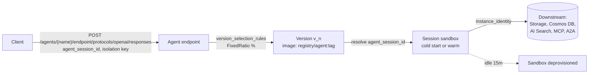
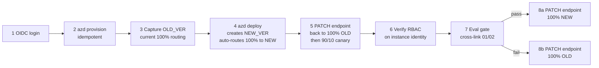
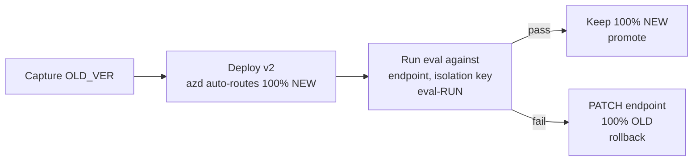
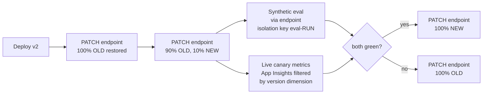

# Deploying Foundry Hosted Agents — A Developer's Guide

> Companion to [Deploying Microsoft Foundry Agents — A Leader's Guide](./foundry-agents-deployment.md).
> Audience: application developers, platform engineers, and ML engineers
> who own a hosted-agent codebase end-to-end.
> Code-rich. Equal weight to **azd**, the **Python SDK**, and **REST /
> `az rest`**.

## TL;DR

- Microsoft has shipped a **new hosted-agents backend**. The boundary is
  the `azd ai agent` extension version: **`0.1.27-preview` and later
  targets the new backend; `0.1.25-preview` targets the legacy Azure
  Container Apps experience.** They are not interchangeable.
- Compute is **serverless**: a sandbox is provisioned per request and
  torn down after a **15-minute idle timeout**. There are no manual
  start/stop operations.
- **Sessions** are first-class. Every Responses-protocol invocation is
  bound to an `agent_session_id`, scoped by an `x-session-isolation-key`
  you choose, and gated by the preview header
  `Foundry-Features: HostedAgents=V1Preview`.
- **Agent endpoints** route traffic to **versions** by
  `version_selection_rules` with `FixedRatio` percentages — that's how
  you do canary deployments. Endpoint changes go through
  `PATCH /agents/{name}` with `Content-Type:
  application/merge-patch+json` and the
  `Foundry-Features: AgentEndpoints=V1Preview` header.
- Each hosted agent has its own **`instance_identity`** — a Microsoft
  Entra service principal distinct from the project managed identity,
  scoped to the agent (not the version). Always assign roles with
  `--assignee-object-id <pid> --assignee-principal-type ServicePrincipal`;
  `--assignee` falls through to a Microsoft Graph lookup that fails for
  agent SPs.
- Hosted agents, sessions, endpoint routing, and Microsoft Entra Agent
  ID are all **preview**. Treat production commitments accordingly and
  re-verify the cited Learn pages before publishing or pinning API
  versions.

## 1. Introduction

### What changed

Hosted agents have moved off Azure Container Apps onto a **new
Foundry-managed backend**. The change is not cosmetic — it affects how
your code runs, how you address it, how it scales, and how you assign
permissions to it.

- **Compute is serverless.** A sandbox is provisioned when a request
  arrives and torn down after a 15-minute idle period. There is no
  always-on revision and no manual start/stop.
- **Sessions are first-class.** Each request runs against an isolated
  sandbox identified by an `agent_session_id`, scoped by a
  caller-defined `x-session-isolation-key`. The Responses API binds
  every call to a session; the Invocations protocol opts out and
  manages state itself.
- **Versions and endpoints are explicit objects.** A version goes
  through `creating → active` (or `failed`); the agent's endpoint
  routes traffic across versions by `version_selection_rules` with
  `FixedRatio` percentages. Canary deployments are a built-in
  primitive.
- **Each agent has its own Microsoft Entra service principal**,
  surfaced as `instance_identity.principal_id` on the agent object
  (one identity per agent, not per version). Downstream RBAC is
  assigned to this identity, not to the project managed identity.
- **`azd ai agent` is now the primary CLI surface**, with a Python SDK
  (`azure-ai-projects ≥ 2.1.0`) and a REST surface (`v1`) that all
  three docs pages cover in equal weight.

This article walks through the developer flow on that new backend,
end-to-end.

### Audience and scope

You are writing the agent code yourself — Microsoft Agent Framework,
LangGraph, Semantic Kernel, or your own orchestration on top of the
OpenAI SDK — and you want concrete commands for **azd, Python, and
REST**. This article is in scope for:

- Building, running, and debugging a hosted agent locally.
- Publishing versions and routing traffic between them.
- Managing sessions explicitly.
- Wiring the instance identity to downstream Azure resources.
- Plugging the result into a CI/CD pipeline and an evaluation gate.

**Out of scope** — the [leader's guide](./foundry-agents-deployment.md)
owns these, and we cross-link rather than re-litigate:

- Choosing between prompt, workflow, and hosted agents.
- Region, subscription, and project topology.
- Private networking, BYO VNet, and CI/CD runner topology against a
  private Foundry.
- Microsoft Entra Agent ID governance and the publishing-identity
  versus runtime-identity separation at the org level.

### The legacy / new-backend boundary

There are now two hosted-agents experiences in the wild. They share a
name and some commands but they are different products:

| | Legacy backend | New backend |
|---|---|---|
| `azd ai agent` extension | `0.1.25-preview` | `0.1.27-preview` and later |
| Underlying compute | Azure Container Apps revisions | Foundry-managed serverless sandbox |
| Lifecycle | Long-running revision; manual scale rules | Per-request sandbox; 15-min idle deprovision |
| Sessions as a concept | No | Yes (`agent_session_id`, isolation key) |
| Endpoint / version routing | Container Apps traffic split | `agent_endpoint.version_selector` with `FixedRatio` |
| Preview headers | n/a | `Foundry-Features: HostedAgents=V1Preview`, `AgentEndpoints=V1Preview` |

To check what an existing project is on:

```bash
azd version
azd ext list
```

If `azure.ai.agents` is at `0.1.25-preview` or lower, you are on the
legacy Container Apps backend and most of this article does not apply
yet. Upgrade with:

```bash
azd ext upgrade azure.ai.agents
```

and confirm the version is `0.1.27-preview` or later before you
continue.

> **Preview.** Hosted agents on the new backend, sessions, agent
> endpoints, and Microsoft Entra Agent ID are all preview. API
> versions, header names, and SDK surfaces can shift before GA.
> Re-verify the cited Learn pages before pinning anything in
> production code.

## 2. Mental model: what a hosted agent actually is now

A hosted agent is no longer "your container, running somewhere." It is
five distinct objects with explicit lifecycles, and most of the work in
this article is about which object owns what.

### Five objects

1. **Container image.** Your code, packaged with whatever framework you
   chose, pushed to your Azure Container Registry. You own the
   Dockerfile, the dependencies, the orchestration logic, the
   telemetry, and the choice of protocol the container exposes
   (`responses`, `invocations`, or both).
2. **Agent version.** A `HostedAgentDefinition` registered with
   Foundry: `image`, `cpu`, `memory`,
   `container_protocol_versions`, env vars. Versions are immutable
   once `active`; new code means a new version. The version goes
   through `creating → active` (or `failed`) and can later be
   `deleting → deleted`.
3. **Agent endpoint.** A routing object attached to the agent. It
   resolves an incoming request to a specific version using
   `version_selection_rules` (today: `FixedRatio` with a
   `traffic_percentage`) and exposes one or both protocols. This is
   the canary primitive.
4. **Session.** A per-request isolated sandbox compute environment.
   The Responses API requires an `agent_session_id` on every call, and
   the platform binds the request to the matching sandbox. Sessions
   are scoped by an `x-session-isolation-key` you choose (a user ID, a
   tenant ID, an eval-run ID — anything). The sandbox is provisioned
   on first request and torn down 15 minutes after the last one.
5. **Instance identity.** A Microsoft Entra service principal created
   for the agent (one identity per agent, not per version), surfaced
   as `instance_identity.principal_id`. This is the principal that
   authenticates from inside the sandbox to downstream resources
   (Storage, Cosmos DB, AI Search, the project itself, anything that
   supports Azure RBAC). It is **not** the project managed identity.

### Who owns what

| Layer | You own | Foundry owns |
|---|---|---|
| Container image | Dockerfile, code, deps, telemetry, protocol choice | Build infrastructure used by `azd deploy` (remote build) |
| Version | `HostedAgentDefinition` values, when to publish | Provisioning, status reporting, image pull |
| Endpoint | Traffic-split policy, protocol exposure | Request routing |
| Session | Isolation-key scheme, lifecycle decisions | Sandbox provisioning, 15-min idle teardown |
| Identity | RBAC on downstream resources | Creating and rotating the Entra service principal |
| Observability | Correlation IDs, business telemetry inside the agent | `:logstream` SSE endpoint, system events |

### How a request flows



The same five objects show up in every section that follows: §3-5 build
the image and the first version, §6 manages versions and the endpoint,
§7 manages sessions, §8 wires the instance identity to downstream
resources, and §9-11 observe and gate the whole flow.

## 3. Prerequisites and one-time setup

### Tooling

| Tool | Minimum version | Notes |
|---|---|---|
| Azure CLI | `2.80` | Required for `az rest` against the Foundry data plane. Authenticate with `az login`. |
| Azure Developer CLI (`azd`) | `1.24.0` | `azd version` to check; `winget upgrade Microsoft.Azd` (Windows) or `brew upgrade azd` (macOS) to update. |
| `azd` agents extension | `0.1.27-preview` | `azd ext install azure.ai.agents` (or `azd ext upgrade azure.ai.agents`). Anything `0.1.25-preview` or lower targets the legacy backend. |
| Python | `3.10` | Local dev only. Use a venv. |
| `azure-ai-projects` | `2.1.0` | New backend SDK. Sessions live under the preview sub-client `project.beta.agents`. |
| `azure-identity` | latest | For `DefaultAzureCredential`. |
| Docker | not required | Container builds run remotely as part of `azd deploy`. Useful only if you want a local image build outside the toolchain. |

VS Code is optional. If you want the integrated experience, install the
**Microsoft Foundry Toolkit for VS Code** ([aka.ms/foundrytk](https://aka.ms/foundrytk))
on its **pre-release** channel — the new-backend commands ship there
first.

### RBAC the developer needs

| Action | Role | Scope | Why |
|---|---|---|---|
| `azd provision` (create RG, Foundry account, project, ACR, Log Analytics, App Insights, model deployment) | **Contributor** | Subscription or RG | Standard ARM resource creation. |
| `azd ai agent init / run / invoke` | _none beyond_ Azure login | local | Local execution against your developer credential. |
| `azd deploy` (publish a new version, assign roles to the agent's instance identity) | **Owner** _or_ **User Access Administrator** | Subscription or RG | The deploy step writes role assignments for the platform-created agent identity. |
| Create / publish hosted agents in a project | **Azure AI Project Manager** | Project | Data-plane permission to author agents and to assign **Azure AI User** to the platform-created agent identity. |
| Pull images from ACR (runtime) | **AcrPull** | ACR | Held by the **Foundry project's managed identity**, not by you. `azd`/VS Code can assign it for you if you have Owner / UAA. |

If you cannot get Owner or User Access Administrator, you can still
develop and provision; an account with that level of access has to run
`azd deploy` for the first version (it stamps the role assignments) and
you can take over for subsequent code-only deploys.

### Resource provider registrations

`azd provision` will fail with `SubscriptionNotRegistered` if any of
these are missing. Register them once per subscription:

```bash
for ns in \
  Microsoft.CognitiveServices \
  Microsoft.MachineLearningServices \
  Microsoft.App \
  Microsoft.ContainerRegistry \
  Microsoft.OperationalInsights \
  Microsoft.Insights \
  Microsoft.Storage \
  Microsoft.KeyVault \
  Microsoft.Network ; do
    az provider register --namespace "$ns"
done
```

For private-network deployments you will need a longer list — see the
[leader's guide §5](./foundry-agents-deployment.md#5-private-networking-for-foundry-agent-service)
for the full set, including `Microsoft.Bing` if you use Grounding with
Bing Search.

### What `azd provision` creates

After `azd ai agent init` and `azd provision`, expect this resource
set in your resource group. Costs and links are summarised; the
[Foundry pricing page](https://azure.microsoft.com/pricing/details/microsoft-foundry/)
is the source of truth.

| Resource | Purpose | Cost shape |
|---|---|---|
| Resource group | Container for everything below. | None. |
| Foundry account + project | Control plane and data plane for agents. | Consumption-based on the project. |
| Model deployment | Reasoning model called by the agent. | Per-token; depends on SKU and region. |
| Azure Container Registry | Stores hosted-agent images. | Basic tier by default. |
| Log Analytics workspace | Backing store for App Insights and `:logstream` history. | Pay-per-GB ingested. |
| Application Insights | Agent telemetry and distributed tracing. | Pay-per-GB; sampled by default. |
| User-assigned managed identity | Project MI used for ACR pulls and federated credentials. | None. |

The **agent's own instance identity** is created later, by Foundry,
when you publish the first version with `azd deploy` — it is not in
the `azd provision` output.

## 4. Build and run locally

The fastest path is `azd ai agent init` → `azd ai agent run` →
`azd ai agent invoke --local`. The VS Code path is functionally
equivalent; pick whichever fits your workflow.

### Initialise a project (`azd`)

In an empty directory:

```bash
azd ai agent init
```

The interactive flow asks for:

- **Language** — Python or C#.
- **Agent template** — sample to start from (web search, MCP, hotels,
  etc.).
- **Model configuration** — deploy a new model into a new Foundry
  project, or attach to an existing project and model deployment.
- **Azure subscription** and **location**.
- **Model SKU** (filtered to what is available in your region and
  subscription).
- **Deployment name** for the model.
- **Container size** — CPU and memory for the sandbox; the default is
  fine for most samples.

For non-interactive environments (CI, SSH), pass `--no-prompt` and
provide every value as a flag.

> **Gotcha — `agent.yaml` placeholder.** If you pick a sample with
> tools but you are **not** wiring an MCP server, comment out or
> delete:
>
> ```yaml
> - name: AZURE_AI_PROJECT_TOOL_CONNECTION_ID
>   value: <CONNECTION_ID_PLACEHOLDER>
> ```
>
> Otherwise the agent starts but fails the first tool call.

Then provision the Azure-side resources from §3:

```bash
azd provision
```

This is a one-time setup per environment. Re-running it is idempotent.

### Initialise a project (VS Code)

If you prefer the toolkit:

1. **Ctrl+Shift+P → Microsoft Foundry: Create Project** — picks
   subscription, RG, and project name.
2. **Microsoft Foundry: Open Model Catalog** → pick a model (for
   example `gpt-4.1`) → **Deploy to Microsoft Foundry**.
3. **Microsoft Foundry: Create new Hosted Agent** — picks framework,
   language, protocol (Responses or Invocations), sample, folder, and
   agent name.

Confirm the Foundry Toolkit and Foundry extensions are on the
**pre-release** channel; new-backend commands ship there first.

### Run the agent locally

The default local server listens on `http://localhost:8088/`.

`azd` path:

```bash
azd ai agent run
```

This sets up the venv, installs `requirements.txt`, and runs the
`startupCommand` from `azure.yaml`. Preview-package version-conflict
warnings during install are non-blocking — the agent still starts.

VS Code path:

- **F5** with the **Debug Local Workflow HTTP Server** launch config,
  or
- a terminal: `python main.py`.

The Foundry Toolkit Agent Inspector opens for interactive testing in
the VS Code path.

### Invoke the local agent

In a second terminal:

```bash
azd ai agent invoke --local "What is Microsoft Foundry?"
```

For Responses-protocol agents, the input is a string. For
Invocations-protocol agents, the payload is JSON — check the sample's
`README.md` for the exact shape.

Curl equivalent:

```bash
curl -sS -H "Content-Type: application/json" \
  -X POST http://localhost:8088/responses \
  -d '{"input":"What is Microsoft Foundry?","stream":false}'
```

PowerShell equivalent (the one place a Windows-specific snippet earns
its keep — `curl` on Windows is an alias for `Invoke-WebRequest` with
different flag semantics):

```powershell
$body = @{ input = "What is Microsoft Foundry?"; stream = $false } |
  ConvertTo-Json
Invoke-RestMethod -Uri http://localhost:8088/responses `
  -Method Post -Body $body -ContentType "application/json"
```

### Common local errors

| Symptom | Cause | Fix |
|---|---|---|
| `AuthenticationError`, `DefaultAzureCredential` failure | Stale or missing Azure session. | `azd auth logout` then `azd auth login`. If `DefaultAzureCredential` still fails, also `az login`. |
| `ResourceNotFound` | Endpoint URLs in env vars don't match Foundry. | Re-copy the project endpoint from the Foundry portal into `.env`. |
| `DeploymentNotFound` | Model deployment name typo. | Check **Build → Deployments** in the Foundry portal. |
| `Connection refused` on `localhost:8088` | Port already bound, or the server crashed during startup. | `lsof -i :8088` (or `Get-NetTCPConnection -LocalPort 8088`); free the port or stop the dead process. |
| Agent starts but the first tool call fails | `AZURE_AI_PROJECT_TOOL_CONNECTION_ID` placeholder still in `agent.yaml`. | Comment it out (see above). |

### Picking a protocol locally

You set the protocol when you scaffold the sample, but it is worth
being deliberate:

- **Responses (OpenAI-compatible).** Stateful per session. Easiest if
  the client already speaks OpenAI's Responses API and you want
  Foundry to manage conversation state. Sessions (§7) are required.
- **Invocations.** The agent owns state; Foundry does not bind
  requests to sessions. Pick this if you already have your own state
  store (a database, a vector store keyed by user, an external
  thread-management service) and you do not want a second one.
- **Both.** A version can expose both; the endpoint's `protocols`
  field decides what is reachable in production. Useful during a
  protocol migration.

## 5. Deploy and verify

### `azd deploy` — what actually happens

```bash
azd deploy
```

Behind the scenes, on the new backend, this single command:

1. **Builds the container image remotely** in your ACR. Docker is not
   needed locally.
2. **Creates a new agent version** by POSTing a `HostedAgentDefinition`
   (image, CPU, memory, protocols) to the project.
3. **Polls the version** until it reaches `active`.
4. **Patches the agent endpoint** to send 100% of traffic to the new
   version (or whatever the `azure.yaml` policy specifies).
5. **Stamps RBAC** on the agent's instance identity — this is why the
   step needs Owner or User Access Administrator. Specifically, it
   assigns **Azure AI User** at project scope so the agent can call the
   model and project tools at runtime.

The output ends with two URLs you should keep handy:

```text
- Agent playground (portal):
  https://ai.azure.com/nextgen/.../build/agents/<agent>/build?version=1
- Agent endpoint:
  https://ai-account-<name>.services.ai.azure.com/api/projects/<project>/agents/<agent>/versions/1
```

The version-pinned URL is a stable identifier for the version (useful
for documentation, audit trails, and direct portal links). Production
**and** canary traffic both flow through the agent endpoint — the URL
without the `/versions/<n>` suffix — and which version handles a given
request is decided by `version_selection_rules` (§6). Eval gates
target a version by pinning the routing temporarily, not by hitting a
side-channel URL (§11).

> **Cost reminder.** Once a version is `active` the agent itself is
> idle-cheap (compute is per-request), but the supporting resources
> (model deployment, App Insights ingestion, ACR storage) keep
> billing. `azd down` removes the entire resource group; use it
> carefully if you share an RG.

### Responses vs Invocations at deploy time

The protocol you exposed locally has to be declared in the version's
`container_protocol_versions`. The deploy step picks that up from
`azure.yaml`; if you change it later, you create a new version. Quick
recap of the trade-offs:

| | Responses | Invocations |
|---|---|---|
| Conversation state | Platform-managed via sessions | You manage it |
| Session API in §7 | Required | Doesn't apply |
| Client SDK | OpenAI Responses-compatible | Your own |
| Best for | New apps; want Foundry to do the heavy lifting | Existing apps with their own state store |
| Expose both? | Yes — useful during migration | Yes |

### Verify the deployment

Three surfaces, same agent. Pick whichever fits your script.

**`azd`:**

```bash
azd ai agent show
azd ai agent show --output table
```

Add the agent name as a positional argument if `azure.yaml` has more
than one service:

```bash
azd ai agent show <agent-name>
```

**REST (`az rest`):**

Set the variables once per shell. They are reused throughout the rest
of this article.

```bash
ACCOUNT_NAME="<your-foundry-account-name>"
PROJECT_NAME="<your-project-name>"
AGENT_NAME="<your-agent-name>"
BASE_URL="https://${ACCOUNT_NAME}.services.ai.azure.com/api/projects/${PROJECT_NAME}"
API_VERSION="v1"
RESOURCE="https://ai.azure.com"

az rest --method GET \
  --url "${BASE_URL}/agents/${AGENT_NAME}?api-version=${API_VERSION}" \
  --resource "${RESOURCE}"
```

> **`--resource` is not optional.** Every `az rest` call to the
> Foundry data plane needs `--resource "https://ai.azure.com"`.
> Without it, `az rest` cannot derive the right Microsoft Entra
> audience from the URL and the call fails with a 401.

**Python:**

```python
from azure.identity import DefaultAzureCredential
from azure.ai.projects import AIProjectClient

project = AIProjectClient(
    endpoint="<your-project-endpoint>",
    credential=DefaultAzureCredential(),
)

agent = project.agents.get(agent_name="my-agent")
print(f"Name: {agent.name}")
print(f"Latest version status: {agent.versions['latest']['status']}")
```

### Smoke test from the playground

Click the **Agent playground (portal)** URL emitted by `azd deploy`,
or:

1. Open <https://ai.azure.com>, sign in, pick the project.
2. **Build → Agents**, click the agent.
3. **Open in playground**, send a test message.

If the playground does not respond, check that the version status is
`active` (`azd ai agent show` or the REST call above). A `failed`
status surfaces an `error` field in the agent JSON — start the
investigation there.

## 6. Versions and the agent endpoint

`azd deploy` is fine for the happy path. For canary deployments,
rollbacks, multiple concurrent versions, or anything CI/CD does on
your behalf, you need to drive versions and endpoints directly.

### Version lifecycle

After `POST /agents/{name}/versions` (or the SDK / `azd` equivalent),
the version moves through these states:

| Status | Meaning |
|---|---|
| `creating` | Infrastructure is being provisioned. Typically 2-5 minutes. |
| `active` | Ready to serve requests. Eligible to receive traffic from the endpoint. |
| `failed` | Provisioning failed. Inspect the `error` field on the version JSON. |
| `deleting` | Cleanup in flight. |
| `deleted` | Fully removed. |

A version is **immutable** once `active`. New code, new env var, new
CPU/memory — every change is a new version.

### Create a new version

**REST:**

```bash
az rest --method POST \
  --url "${BASE_URL}/agents/${AGENT_NAME}/versions?api-version=${API_VERSION}" \
  --resource "${RESOURCE}" \
  --body '{
    "definition": {
      "kind": "hosted",
      "image": "myregistry.azurecr.io/my-agent:v2",
      "cpu": "1",
      "memory": "2Gi",
      "container_protocol_versions": [
        {"protocol": "responses", "version": "1.0.0"}
      ]
    }
  }'
```

Replace `responses` with `invocations` if that's your protocol, or
include both entries to expose both.

**Python:**

```python
from azure.ai.projects.models import (
    HostedAgentDefinition, ProtocolVersionRecord,
)

agent = project.agents.create_version(
    agent_name="my-agent",
    definition=HostedAgentDefinition(
        cpu="1",
        memory="2Gi",
        image="myregistry.azurecr.io/my-agent:v2",
        container_protocol_versions=[
            ProtocolVersionRecord(protocol="responses", version="1.0.0"),
        ],
    ),
)
print(f"Created version: {agent.version}")
```

**`azd`:** A new version is created automatically when you re-run
`azd deploy` with updated code or configuration. There is no
standalone "create version" command.

### Poll until `active`

Versions are created asynchronously. Poll before promoting traffic.

**Python:**

```python
import time

def wait_for_version_active(project, agent_name, agent_version,
                            max_attempts=60, interval_s=10):
    for attempt in range(max_attempts):
        time.sleep(interval_s)
        version = project.agents.get_version(
            agent_name=agent_name, agent_version=agent_version,
        )
        status = version["status"]
        print(f"Version status: {status} (attempt {attempt + 1})")
        if status == "active":
            return version
        if status == "failed":
            raise RuntimeError(f"Provisioning failed: {dict(version)}")
    raise RuntimeError("Timed out waiting for version to become active")
```

**REST (bash):**

```bash
for i in $(seq 1 60); do
  STATUS=$(az rest --method GET \
    --url "${BASE_URL}/agents/${AGENT_NAME}/versions/2?api-version=${API_VERSION}" \
    --resource "${RESOURCE}" \
    --query "status" -o tsv)
  echo "attempt $i: $STATUS"
  case "$STATUS" in
    active)  break ;;
    failed)  echo "version failed"; exit 1 ;;
  esac
  sleep 10
done
```

### List versions

```bash
az rest --method GET \
  --url "${BASE_URL}/agents/${AGENT_NAME}/versions?api-version=${API_VERSION}" \
  --resource "${RESOURCE}"
```

```python
for v in project.agents.list_versions(agent_name="my-agent"):
    print(f"Version: {v.version}, Status: {v['status']}")
```

`azd ai agent show` reports the version recorded in your project
config — it is not a substitute for `list_versions` when CI/CD juggles
multiple versions in flight.

### Endpoint routing — the canary primitive

The agent endpoint is what production clients call. It owns:

- `version_selector.version_selection_rules` — a list of
  `{agent_version, traffic_percentage, type: "FixedRatio"}` entries
  that must sum to 100.
- `protocols` — the subset of the underlying versions' protocols
  exposed externally.

Endpoint changes go through a JSON merge patch. Two non-obvious
requirements:

- `Content-Type: application/merge-patch+json` (not the default
  `application/json`).
- `Foundry-Features: AgentEndpoints=V1Preview` header — the endpoint
  surface is preview.

**Pin 100% to a single version:**

```bash
az rest --method PATCH \
  --url "${BASE_URL}/agents/${AGENT_NAME}?api-version=${API_VERSION}" \
  --resource "${RESOURCE}" \
  --headers "Content-Type=application/merge-patch+json" \
            "Foundry-Features=AgentEndpoints=V1Preview" \
  --body '{
    "agent_endpoint": {
      "version_selector": {
        "version_selection_rules": [
          {"agent_version": "1", "traffic_percentage": 100, "type": "FixedRatio"}
        ]
      },
      "protocols": ["responses"]
    }
  }'
```

**90 / 10 canary between v1 and v2:**

```bash
az rest --method PATCH \
  --url "${BASE_URL}/agents/${AGENT_NAME}?api-version=${API_VERSION}" \
  --resource "${RESOURCE}" \
  --headers "Content-Type=application/merge-patch+json" \
            "Foundry-Features=AgentEndpoints=V1Preview" \
  --body '{
    "agent_endpoint": {
      "version_selector": {
        "version_selection_rules": [
          {"agent_version": "1", "traffic_percentage": 90, "type": "FixedRatio"},
          {"agent_version": "2", "traffic_percentage": 10, "type": "FixedRatio"}
        ]
      },
      "protocols": ["responses"]
    }
  }'
```

**Python equivalent:**

```python
from azure.ai.projects.models import (
    AgentEndpoint, AgentEndpointProtocol,
    FixedRatioVersionSelectionRule, VersionSelector,
)

endpoint_config = AgentEndpoint(
    version_selector=VersionSelector(
        version_selection_rules=[
            FixedRatioVersionSelectionRule(agent_version="1", traffic_percentage=90),
            FixedRatioVersionSelectionRule(agent_version="2", traffic_percentage=10),
        ]
    ),
    protocols=[AgentEndpointProtocol.RESPONSES],
)

project.beta.agents.patch_agent_details(
    agent_name="my-agent",
    agent_endpoint=endpoint_config,
)
```

Set `protocols` to `["invocations"]` or `["responses", "invocations"]`
to expose Invocations-protocol versions, or both during a migration.

### Rollback

A rollback is just another endpoint PATCH that flips traffic back to
the previous `active` version. Keep at least the previous N versions
around (do not auto-delete on success) so a one-line PATCH can restore
service. We use this in §10's CI/CD recipe.

### Delete a version or an agent

Only delete versions you are sure you no longer need for rollback or
forensics. Active sessions on a deleted version terminate immediately.

```bash
# Delete a single version
az rest --method DELETE \
  --url "${BASE_URL}/agents/${AGENT_NAME}/versions/1?api-version=${API_VERSION}" \
  --resource "${RESOURCE}"

# Delete the entire agent and every version
az rest --method DELETE \
  --url "${BASE_URL}/agents/${AGENT_NAME}?api-version=${API_VERSION}" \
  --resource "${RESOURCE}"
```

Python: `project.agents.delete_version(...)` and
`project.agents.delete(...)`. `azd` does not expose either as a
standalone command today.

## 7. Sessions

Sessions are the new-backend feature most likely to surprise you.
Every Responses-protocol invocation is bound to a session — there is
no "stateless ping" mode. If you skip explicit session creation, the
client SDKs and `azd` create one for you implicitly, but you should
not rely on that in production code; you lose control over isolation
keys and explicit teardown.

> **Preview gate.** Every session-related request needs the
> `Foundry-Features: HostedAgents=V1Preview` header. Without it the
> call is rejected.

### What a session is

A session is an isolated sandbox-compute environment owned by a
single conversation or task. It has:

- An opaque `agent_session_id` returned at create time.
- An **isolation key** you choose at create time (`x-session-isolation-key`
  header). This is a free-form string — a user ID, a tenant ID, an
  eval-run ID, anything that gives you the boundary you want. The same
  key is required to delete the session.
- A status (`creating`, `active`, etc., reported by the get/list
  endpoints).
- A 15-minute idle deprovision timer. The session object survives;
  the underlying compute is recycled.

The endpoint resolves the agent version (via the rules from §6); you
do not pick a version when you create a session.

### Create a session

**REST:**

```bash
AGENT_NAME="my-agent"

az rest --method POST \
  --url "${BASE_URL}/agents/${AGENT_NAME}/endpoint/sessions?api-version=${API_VERSION}" \
  --resource "${RESOURCE}" \
  --headers "x-session-isolation-key=user-123" \
            "Foundry-Features=HostedAgents=V1Preview" \
  --body "{}"
```

**Python:**

```python
session = project.beta.agents.create_session(
    agent_name="my-agent",
    isolation_key="user-123",
    body={},
)
print(f"Session: {session.agent_session_id} (status: {session.status})")
```

Note `project.beta.agents` — sessions live under the preview
sub-client, so make sure your `AIProjectClient` is constructed with
`allow_preview=True` if you have not already:

```python
project = AIProjectClient(
    endpoint="<your-project-endpoint>",
    credential=DefaultAzureCredential(),
    allow_preview=True,
)
```

**`azd`:** Creating a session as a standalone step is not exposed
today. `azd ai agent invoke` creates one for you on the fly.

### Invoke through a session

This is where the `agent_session_id` actually matters — it goes in the
request body, not in a header.

**REST (Responses API):**

```bash
SESSION_ID="<from create>"

az rest --method POST \
  --url "${BASE_URL}/agents/${AGENT_NAME}/endpoint/protocols/openai/responses?api-version=${API_VERSION}" \
  --resource "${RESOURCE}" \
  --headers "Foundry-Features=HostedAgents=V1Preview" \
  --body "{
    \"input\": \"Find me hotels in Seattle under \$200 per night\",
    \"stream\": false,
    \"agent_session_id\": \"${SESSION_ID}\"
  }"
```

**Python:**

```python
openai_client = project.get_openai_client(agent_name="my-agent")

response = openai_client.responses.create(
    input="Find me hotels in Seattle under $200 per night",
    extra_body={"agent_session_id": session.agent_session_id},
)
print(response.output_text)
```

`get_openai_client(agent_name=...)` configures the OpenAI client to
route to the right agent endpoint — you do not have to wire base URLs
yourself.

**`azd`:**

```bash
azd ai agent invoke --input "Find me hotels in Seattle under $200 per night"
```

For Invocations-protocol agents, sessions don't apply — see the
Quickstart's "Invoke the agent" section for the protocol-specific
payload shape.

### List, get, delete

```bash
# List
az rest --method GET \
  --url "${BASE_URL}/agents/${AGENT_NAME}/endpoint/sessions?api-version=${API_VERSION}" \
  --resource "${RESOURCE}" \
  --headers "Foundry-Features=HostedAgents=V1Preview"

# Get one
az rest --method GET \
  --url "${BASE_URL}/agents/${AGENT_NAME}/endpoint/sessions/${SESSION_ID}?api-version=${API_VERSION}" \
  --resource "${RESOURCE}" \
  --headers "Foundry-Features=HostedAgents=V1Preview"

# Delete (isolation key MUST match the create call)
az rest --method DELETE \
  --url "${BASE_URL}/agents/${AGENT_NAME}/endpoint/sessions/${SESSION_ID}?api-version=${API_VERSION}" \
  --resource "${RESOURCE}" \
  --headers "x-session-isolation-key=user-123" \
            "Foundry-Features=HostedAgents=V1Preview"
```

```python
# List
for s in project.beta.agents.list_sessions(agent_name="my-agent"):
    print(f"{s.agent_session_id} ({s.status})")

# Get
project.beta.agents.get_session(agent_name="my-agent", session_id=SESSION_ID)

# Delete
project.beta.agents.delete_session(
    agent_name="my-agent",
    session_id=SESSION_ID,
    isolation_key="user-123",
)
```

`azd` does not expose `list`, `get`, or explicit `delete` as standalone
commands. Use REST or Python from your own scripts.

### Practical patterns

- **Pick an isolation-key scheme up front.** Per-end-user is the
  default for chatbot-style UX. Per-tenant is right for multi-tenant
  SaaS. Per-eval-run is right for evaluation pipelines (§11). Mixing
  schemes inside one agent is a debugging nightmare; pick one and
  document it.
- **Treat sessions as cheap but not free.** The session object itself
  is light, but each new session is a potential cold start when the
  next request lands. Reuse a session across turns of the same
  conversation; do not create a new session per request.
- **Tear sessions down explicitly when you can.** The 15-minute idle
  reclaim covers the unhappy path; deterministic deletes give you
  cleaner cost lines and better forensics. Always delete sessions
  you created for tests, evals, or one-off scripts.
### Session file operations

Each session sandbox has a file system you can read and write into.
Files are scoped to the session — they go away when the session is
deleted (and cold-restored from session-attached storage on next
warm-up while the session itself is alive). The maximum upload size
is 50 MB.

This is the natural channel for code-interpreter-style tasks where
the agent needs to operate on user-supplied data, or for snapshotting
intermediate artifacts an eval might want to inspect.

**Upload (REST):**

```bash
az rest --method PUT \
  --url "${BASE_URL}/agents/${AGENT_NAME}/endpoint/sessions/${SESSION_ID}/files/content?api-version=${API_VERSION}&path=data.csv" \
  --resource "${RESOURCE}" \
  --body @data.csv \
  --headers "Content-Type=application/octet-stream" \
            "Foundry-Features=HostedAgents=V1Preview"
```

**Upload (Python):**

```python
project.beta.agents.upload_session_file(
    agent_name="my-agent",
    session_id=SESSION_ID,
    content_or_file_path="./data.csv",
    path="data.csv",
)
```

**Upload (`azd`):**

```bash
azd ai agent files upload --file ./data.csv --target-path data.csv
```

**List, download, delete:**

```bash
# List (REST)
az rest --method GET \
  --url "${BASE_URL}/agents/${AGENT_NAME}/endpoint/sessions/${SESSION_ID}/files?api-version=${API_VERSION}&path=." \
  --resource "${RESOURCE}" \
  --headers "Foundry-Features=HostedAgents=V1Preview"

# Download (REST)
az rest --method GET \
  --url "${BASE_URL}/agents/${AGENT_NAME}/endpoint/sessions/${SESSION_ID}/files/content?api-version=${API_VERSION}&path=data.csv" \
  --resource "${RESOURCE}" \
  --headers "Foundry-Features=HostedAgents=V1Preview" \
  --output-file output.csv

# Delete (REST)
az rest --method DELETE \
  --url "${BASE_URL}/agents/${AGENT_NAME}/endpoint/sessions/${SESSION_ID}/files?api-version=${API_VERSION}&path=data.csv" \
  --resource "${RESOURCE}" \
  --headers "Foundry-Features=HostedAgents=V1Preview"
```

```python
# List
files = project.beta.agents.get_session_files(
    agent_name="my-agent", agent_session_id=SESSION_ID, path=".",
)
for entry in files.entries:
    print(f"  {entry.name} (size={entry.size}, dir={entry.is_dir})")

# Download
content = b"".join(project.beta.agents.download_session_file(
    agent_name="my-agent", agent_session_id=SESSION_ID, path="data.csv",
))

# Delete
project.beta.agents.delete_session_file(
    agent_name="my-agent", agent_session_id=SESSION_ID, path="data.csv",
)
```

```bash
# azd
azd ai agent files list .
azd ai agent files download --file data.csv --target-path ./output.csv
azd ai agent files remove --file data.csv
```

A few practical notes:

- **The 50 MB upload limit is per-file.** Chunk anything larger
  before upload, or stage the data in Azure Blob Storage and have
  the agent fetch it at runtime using its instance identity.
- **Files do not survive session deletion.** If you need durable
  artifacts, copy them out to Storage at the end of the run (the
  agent code can do this directly) or download them with the API
  before you call `delete_session`.
- **Use `path=.` to list the working directory.** Subdirectories are
  addressed with relative paths, same as a normal POSIX file system.

## 8. The instance identity and downstream RBAC

Each hosted agent has its own Microsoft Entra service principal,
created by Foundry the first time the agent is published. It is the
principal that runs inside the sandbox and authenticates outbound to
anything that speaks Azure RBAC: the project itself, Azure Storage,
Cosmos DB, AI Search, MCP / A2A endpoints registered with the agent
identity model, and so on.

Two things matter at the developer level:

1. The instance identity is **not** the project managed identity. The
   project MI handles ACR pulls and federated credentials; the
   instance identity is what your code authenticates as at runtime.
2. The instance identity is per **agent**, not per version, so role
   assignments survive a normal version publish. You still want CI/CD
   to **verify** the expected role assignments after every deploy
   (and create them on the first deploy or after recovery scenarios)
   — see §10. Treat verification as cheap insurance, not a redundant
   step.

> **Note on the leader's guide.** The
> [leader's guide §7](./foundry-agents-deployment.md#7-security-identity-and-governance)
> discusses Foundry's broader publish-creates-new-identity model,
> which applies to other agent types and to publish workflows that
> create new agent application objects. On the new hosted-agents
> backend, the `instance_identity` retrieved from `GET /agents/{name}`
> is per-agent. Re-verify before relying on either claim in a
> regulated environment — the surface is preview.

### Extract the principal ID

**REST:**

```bash
AGENT_IDENTITY=$(az rest --method GET \
  --url "${BASE_URL}/agents/${AGENT_NAME}?api-version=${API_VERSION}" \
  --resource "${RESOURCE}" \
  --query "instance_identity.principal_id" \
  --output tsv)

echo "Agent identity principal ID: ${AGENT_IDENTITY}"
```

**Python:**

```python
agent = project.agents.get(agent_name="my-agent")
agent_identity = agent.instance_identity["principal_id"]
print(f"Agent identity principal ID: {agent_identity}")
```

**`azd`:** Not exposed as a standalone command. Use REST or Python.

### Assign roles correctly

The single most common failure mode here is assigning a role the
"normal" way (`--assignee <pid>`) and then watching the agent fail at
runtime with `403 Forbidden`. The reason is that `--assignee` falls
through to a Microsoft Graph lookup, and Graph does not resolve agent
service principals the same way it resolves user-created SPs.

**Always use `--assignee-object-id` plus
`--assignee-principal-type ServicePrincipal`:**

```bash
# Project-level access (model + project tools)
az role assignment create \
  --assignee-object-id "$AGENT_IDENTITY" \
  --assignee-principal-type ServicePrincipal \
  --role "Azure AI Developer" \
  --scope "/subscriptions/<sub>/resourceGroups/<rg>/providers/Microsoft.CognitiveServices/accounts/<account>/projects/<project>"

# Read/write a storage account
az role assignment create \
  --assignee-object-id "$AGENT_IDENTITY" \
  --assignee-principal-type ServicePrincipal \
  --role "Storage Blob Data Contributor" \
  --scope "/subscriptions/<sub>/resourceGroups/<rg>/providers/Microsoft.Storage/storageAccounts/<storage>"
```

Common scope/role combinations to plan for up front:

| Downstream | Role | Notes |
|---|---|---|
| Foundry project (model + project tools) | **Azure AI Developer** or **Azure AI User** | `azd deploy` already stamps **Azure AI User**; use **Developer** if the agent needs to create/manage project artifacts. |
| Azure Storage (blob) | **Storage Blob Data Contributor** (or Reader) | At storage account or container scope. |
| Azure Cosmos DB | **Cosmos DB Built-in Data Contributor** | Cosmos uses its own data-plane role model; see the Cosmos docs for the data-plane vs control-plane split. |
| Azure AI Search | **Search Index Data Contributor** (or Reader) | Per-index scope is supported. |
| Key Vault (secrets) | **Key Vault Secrets User** | Only if you read secrets from inside the agent — prefer references via env vars resolved at deploy time. |

Python equivalents are available via the
[Azure Authorization Management SDK](https://learn.microsoft.com/en-us/python/api/azure-mgmt-authorization)
if you want to script role assignments without shelling out. The
shape mirrors the CLI: pass `principal_id`, `principal_type=
"ServicePrincipal"`, and the role definition ID.

### Verify role assignments

```bash
# At project scope
az role assignment list \
  --assignee "$AGENT_IDENTITY" \
  --scope "/subscriptions/<sub>/resourceGroups/<rg>/providers/Microsoft.CognitiveServices/accounts/<account>/projects/<project>" \
  --output table

# At a storage account scope
az role assignment list \
  --assignee "$AGENT_IDENTITY" \
  --scope "/subscriptions/<sub>/resourceGroups/<rg>/providers/Microsoft.Storage/storageAccounts/<storage>" \
  --output table
```

`--assignee` is fine for **listing** — it is only the create call that
needs `--assignee-object-id` plus `--assignee-principal-type
ServicePrincipal`.

### Verify after every publish

Build a verification step into your pipeline (§10). After `azd
deploy`, the minimum viable check is:

1. Resolve `instance_identity.principal_id` from
   `GET /agents/{name}` (it should match what you have on file for
   this agent).
2. For each downstream resource the agent talks to, run
   `az role assignment list --assignee <pid> --scope <scope>` and
   confirm the expected role is present.
3. If any expected assignment is missing — first-time deploy, drift,
   or a recovery scenario — `az role assignment create` with the
   flags above.

This is much faster than a forensics session at 02:00 on a Saturday
when the agent starts returning 403 from a downstream resource.

## 9. Logs and monitoring

There are three layers of observability on a hosted agent: live
container logs (per session), system events (start/stop), and
Application Insights / Log Analytics for everything you instrument
inside the agent code. Treat them as complementary, not redundant.

### `azd ai agent monitor`

The friendliest entry point. Useful for interactive debugging.

```bash
# Recent container console logs for the configured agent
azd ai agent monitor

# Last N lines
azd ai agent monitor --tail 20

# System events only (container start / stop)
azd ai agent monitor --type system

# Stream a specific session's logs in real time
azd ai agent monitor --session <session-id> --follow

# When azure.yaml has multiple agent services
azd ai agent monitor <agent-name> --follow
```

### REST `:logstream`

For CI/CD or anything programmatic, go to the SSE endpoint directly.

```bash
AGENT_VERSION="<version>"
SESSION_ID="<session-id>"

az rest --method GET \
  --url "${BASE_URL}/agents/${AGENT_NAME}/versions/${AGENT_VERSION}/sessions/${SESSION_ID}:logstream?api-version=${API_VERSION}" \
  --resource "${RESOURCE}" \
  --headers "Foundry-Features=HostedAgents=V1Preview" \
            "Accept=text/event-stream"
```

Each SSE frame looks like:

```text
event: log
data: {"timestamp":"2026-04-09T08:43:59.067Z","stream":"stdout","message":"INFO 127.0.0.1:42588 - GET /readiness 200 OK"}
```

Two limits to design around:

- **Connection cap: 30 minutes.** The server hangs up at 30 minutes
  regardless of activity. Reconnect from the client.
- **Idle timeout: 2 minutes.** If the agent has not produced log
  output for 2 minutes the connection drops. Either reconnect, or
  emit a heartbeat from inside the agent (a periodic `INFO heartbeat`
  log line) so long-quiet sessions stay attached.

### Python SDK gap

There is no Python SDK helper for `:logstream` today. You have two
options:

- Shell out to `az rest` (or `curl` with a federated token) and parse
  the SSE stream in Python.
- Skip live streaming and read the same logs from Application
  Insights with a 1-2 minute ingestion delay (often enough for
  CI/CD).

### Application Insights and Log Analytics

`azd provision` wires up an Application Insights instance and a
Log Analytics workspace. To get value out of them, your agent code
needs to:

- **Emit a correlation ID per request.** A common pattern: pull the
  `agent_session_id` from the incoming request (or the
  `x-request-id` header your gateway adds) and put it on every log
  line. Then `monitor`'s output lines and App Insights traces line
  up.
- **Use OpenTelemetry inside the container.** The OpenTelemetry SDK
  for Python (or the OTel + App Insights distro) auto-instruments
  HTTP and the OpenAI SDK, so prompts, responses, and outbound calls
  show up as a single distributed trace per session.
- **Tag traces with the version.** Read the agent version from an env
  var the deploy step injects, and add it as a custom dimension. You
  want to see at a glance which version a regression came from
  during a canary.

For instrumentation patterns, the appinsights-instrumentation skill
in this repo and the
[App Insights Python distro docs](https://learn.microsoft.com/en-us/azure/azure-monitor/app/opentelemetry-enable?tabs=python)
are the right starting points.

### When to use which

| Need | Use |
|---|---|
| "Show me what the container just printed for session X" | `azd ai agent monitor --session X --follow` |
| "Stream logs from a CI/CD job for 30 minutes" | REST `:logstream` with reconnect |
| "Is this session even alive?" | REST `GET .../sessions/{id}` for status |
| "Did v2 break anything in the last hour?" | App Insights / Log Analytics with the version dimension |
| "Cross-service trace from API gateway → agent → Cosmos" | OpenTelemetry distributed trace in App Insights |

## 10. CI/CD recipe

A minimal pipeline that exercises everything from §6-9 has eight
steps. The non-obvious one is **step 4**: `azd deploy` patches the
endpoint to send 100% of traffic to the new version automatically. If
you want a canary, you have to capture the previous version first and
revert routing immediately after `azd deploy`, before any meaningful
amount of production traffic lands on the unvalidated version. The
example uses GitHub Actions with OIDC federation; the shape is
identical in Azure DevOps.



### Pipeline skeleton

```yaml
# .github/workflows/deploy-hosted-agent.yml
name: Deploy hosted agent

on:
  push:
    branches: [main]

permissions:
  id-token: write   # OIDC
  contents: read

concurrency:
  group: deploy-${{ vars.AGENT_NAME }}
  cancel-in-progress: false

env:
  AZURE_CLIENT_ID:       ${{ vars.AZURE_CLIENT_ID }}
  AZURE_TENANT_ID:       ${{ vars.AZURE_TENANT_ID }}
  AZURE_SUBSCRIPTION_ID: ${{ vars.AZURE_SUBSCRIPTION_ID }}
  ACCOUNT_NAME:          ${{ vars.FOUNDRY_ACCOUNT }}
  PROJECT_NAME:          ${{ vars.FOUNDRY_PROJECT }}
  AGENT_NAME:            ${{ vars.AGENT_NAME }}
  CANARY_PERCENT:        "10"

jobs:
  deploy:
    runs-on: ubuntu-latest
    steps:
      - uses: actions/checkout@v4

      # 1. OIDC login
      - uses: azure/login@v2
        with:
          client-id:       ${{ env.AZURE_CLIENT_ID }}
          tenant-id:       ${{ env.AZURE_TENANT_ID }}
          subscription-id: ${{ env.AZURE_SUBSCRIPTION_ID }}

      - name: Install azd + agents extension
        run: |
          curl -fsSL https://aka.ms/install-azd.sh | bash
          azd ext install azure.ai.agents

      # 2. Provision (idempotent — usually a no-op after the first run)
      - run: azd provision --no-prompt

      # 3. Capture current 100% routing BEFORE the deploy auto-promotes
      - name: Capture previous version
        id: old
        run: |
          BASE_URL="https://${ACCOUNT_NAME}.services.ai.azure.com/api/projects/${PROJECT_NAME}"
          OLD_VER=$(az rest --method GET \
            --url "${BASE_URL}/agents/${AGENT_NAME}?api-version=v1" \
            --resource "https://ai.azure.com" \
            --query "agent_endpoint.version_selector.version_selection_rules[?traffic_percentage==\`100\`].agent_version | [0]" \
            -o tsv)
          if [ -z "$OLD_VER" ]; then
            echo "::warning::No single 100%% version found; treating as first deploy."
          fi
          echo "old_version=${OLD_VER}" >> "$GITHUB_OUTPUT"

      # 4. Deploy: builds image, creates new version, AUTO-ROUTES 100% to new
      - run: azd deploy --no-prompt

      - name: Resolve new version
        id: new
        run: |
          BASE_URL="https://${ACCOUNT_NAME}.services.ai.azure.com/api/projects/${PROJECT_NAME}"
          NEW_VER=$(az rest --method GET \
            --url "${BASE_URL}/agents/${AGENT_NAME}?api-version=v1" \
            --resource "https://ai.azure.com" \
            --query "versions.latest.version" -o tsv)
          echo "new_version=${NEW_VER}" >> "$GITHUB_OUTPUT"

      # 5a. Revert routing back to OLD_VER 100% (undo azd's auto-promote)
      - name: Revert to previous version
        if: steps.old.outputs.old_version != ''
        env:
          OLD_VER: ${{ steps.old.outputs.old_version }}
        run: ./scripts/patch-endpoint-100.sh "$OLD_VER"

      # 5b. Then canary OLD/NEW
      - name: Canary patch
        if: steps.old.outputs.old_version != ''
        env:
          OLD_VER: ${{ steps.old.outputs.old_version }}
          NEW_VER: ${{ steps.new.outputs.new_version }}
        run: ./scripts/patch-endpoint-canary.sh "$OLD_VER" "$NEW_VER" "$CANARY_PERCENT"

      # 6. Verify the agent's instance identity has the expected RBAC
      - name: Verify RBAC
        run: ./scripts/verify-agent-rbac.sh

      # 7. Evaluation gate (cross-link to articles 01 / 02)
      - name: Run evaluation against the canary slice
        env:
          NEW_VER:       ${{ steps.new.outputs.new_version }}
          ISOLATION_KEY: "eval-${{ github.run_id }}"
        run: ./scripts/run-eval.sh "$NEW_VER" "$ISOLATION_KEY"

      # 8. Promote on success, rollback on failure
      - name: Promote
        if: success()
        env:
          NEW_VER: ${{ steps.new.outputs.new_version }}
        run: ./scripts/patch-endpoint-100.sh "$NEW_VER"

      - name: Rollback
        if: failure() && steps.old.outputs.old_version != ''
        env:
          OLD_VER: ${{ steps.old.outputs.old_version }}
        run: ./scripts/patch-endpoint-100.sh "$OLD_VER"
```

The helper scripts are thin wrappers around the `az rest` PATCH from
§6 — keep them in `scripts/` so a human can re-run the rollback by
hand at 02:00 without reading YAML. `verify-agent-rbac.sh` is the
loop from §8 ("Verify after every publish").

> **Why not just disable `azd deploy`'s auto-route?** Today the
> tooling does not expose a clean flag to skip endpoint promotion.
> Capturing `OLD_VER` before deploy and reverting immediately after
> is the supported workaround. Watch the `azd ai agent` extension
> changelog — once a `--skip-endpoint-promotion` flag (or
> equivalent) ships, simplify steps 3 and 5a.

### Identity hand-off

Two identities, two jobs:

- **Workflow identity** (`AZURE_CLIENT_ID`): an Entra app or
  user-assigned managed identity with **OIDC federation** to your
  GitHub repo / branch / environment. Needs **Contributor** plus
  **Owner** or **User Access Administrator** on the subscription/RG
  (because `azd deploy` writes role assignments on first deploy),
  and **Azure AI Project Manager** at project scope to publish
  agents.
- **Instance identity** (the agent's own SP): per-agent, not per
  version, so role assignments persist across deploys. Step 6
  verifies them after every deploy and re-creates any that are
  missing.

Never use a long-lived secret for the workflow identity. Federate.

### Running against a private Foundry

Default GitHub-hosted runners cannot reach a private Foundry. The
[leader's guide §6](./foundry-agents-deployment.md#6-cicd-from-github-against-a-private-foundry-new)
covers the three runner patterns (VNet-injected GitHub-hosted,
Container Apps jobs, VM/AKS) and the OIDC-federation requirements.
The pipeline above is the same; only the `runs-on:` label and the
network setup change.

### Things to keep an eye on

- **Publish-window race conditions.** If two pipeline runs publish at
  once, both create new versions and the second one's PATCH wins.
  The `concurrency:` block above prevents that.
- **Don't auto-delete previous versions.** Step 8b's rollback PATCH
  needs the previous version to exist. Keep at least the previous N
  (3 is a reasonable default) and prune separately on a schedule.
- **Bake the version into App Insights.** Inject the version env var
  in `azure.yaml` so traces from a canary version are filterable —
  otherwise eval-gate diagnostics get a lot harder.
- **First-deploy edge case.** On the very first deploy there is no
  `OLD_VER`; the pipeline above skips the revert/canary and lets
  `azd deploy`'s 100% promotion stand. Run a smoke test in the eval
  gate so you don't ship an untested first version.

## 11. Evaluation hand-off

The new backend gives you two primitives that are tailor-made for the
evaluation pipelines from
[Building AI Evaluation Pipelines on Azure](../01-pipeline-overview/ai-eval-pipeline-overview.md):
**explicit version routing on the agent endpoint** and **session
isolation keys**. Use them deliberately so eval traffic does not
pollute production state and so each run is reproducible.

### Three principles

1. **Pin every eval to a specific version.** The cleanest primitive
   is to drive `version_selection_rules` from your eval pipeline so
   the slice under test resolves to exactly the version you intend.
   Always record the version next to the eval results — eval numbers
   without a version are noise.
2. **Use a dedicated isolation key per eval run.** Tag every session
   the eval creates with something like `eval-${RUN_ID}` (the GitHub
   Actions `run_id`, an MLflow run ID, whatever you already track).
   This separates eval sessions from real users for cost reporting,
   debugging, and cleanup.
3. **Tear down deterministically.** Always call `DELETE` on every
   session the eval created at the end of the run. The 15-minute idle
   reclaim is a backstop, not a strategy. Cost lines and forensic
   queries are much cleaner when eval sessions disappear on a
   predictable schedule.

> **About the version-pinned URL.** `azd deploy` prints
> `.../agents/<agent>/versions/<n>` as a stable identifier for the
> version. The cited Learn pages do **not** document a version-pinned
> Responses-API or sessions invocation path — invocations and
> sessions go through `/agents/{name}/endpoint/...` and are routed by
> `version_selection_rules`. Treat the version-pinned URL as a
> reference (audit trails, portal links, version metadata), not as
> an alternate invocation channel. Pin by routing.

### Pattern A — pre-promotion eval

Best for major version bumps where you do **not** want production
traffic on the new code until evals pass. Practical only when the
agent has no real users on it (test environment, scheduled
maintenance window) — because temporarily routing 100% to the new
version is the only fully supported way to address it from clients.



Mechanically:

- Capture `OLD_VER` from the endpoint before deploy (the same
  routing-snapshot trick from §10).
- `azd deploy` creates v2 and auto-routes 100% to it. Use this
  window as the eval window — the eval pipeline talks to the regular
  endpoint URL.
- On pass, leave routing where it is. On fail, PATCH 100% back to
  `OLD_VER`.

If the agent is already serving real users and you cannot afford to
have them on an unvalidated version even briefly, use Pattern B
instead.

### Pattern B — live canary eval (90/10)

Best for incremental changes where you want a small slice of real
traffic on the new version while you run synthetic evals in parallel.
This is the default production pattern and is what §10's CI/CD
recipe implements.



Two things to wire up:

- **Synthetic eval** — call the regular endpoint with
  `eval-${RUN_ID}` as the isolation key. Each call lands on either
  v1 or v2 according to the canary split; tag responses with the
  `agent_version` returned in the response metadata so you can
  filter by version after the fact. Delete every session at the end.
- **Live canary metrics** — App Insights filtered by the version
  custom dimension (§9). Compare token usage, latency, and error
  rates between v1 and v2 over the canary window.

If you need every synthetic-eval call to hit v2 specifically (rather
than 10% of them), temporarily flip the split to 100% NEW for the
eval window — same shape as Pattern A.

The promote / rollback step is a single endpoint PATCH either way.

### Eval-run scaffolding

A minimal eval driver that respects the principles above:

```python
import os, uuid
from azure.identity import DefaultAzureCredential
from azure.ai.projects import AIProjectClient

EVAL_RUN_ID = os.environ.get("EVAL_RUN_ID", str(uuid.uuid4()))
ISOLATION   = f"eval-{EVAL_RUN_ID}"
AGENT_NAME  = os.environ["AGENT_NAME"]
AGENT_VER   = os.environ["AGENT_VERSION"]   # the version you expect to be under test

project = AIProjectClient(
    endpoint=os.environ["PROJECT_ENDPOINT"],
    credential=DefaultAzureCredential(),
    allow_preview=True,
)

session = project.beta.agents.create_session(
    agent_name=AGENT_NAME,
    isolation_key=ISOLATION,
    body={},
)

try:
    openai_client = project.get_openai_client(agent_name=AGENT_NAME)
    for case in load_eval_cases():
        response = openai_client.responses.create(
            input=case.input,
            extra_body={"agent_session_id": session.agent_session_id},
        )
        # Confirm which version actually handled the call (canary split).
        # The exact field name may shift before GA — re-verify against the
        # current Learn page. Fall back to checking the App Insights
        # version dimension if the response doesn't carry it.
        served_version = (
            getattr(response, "agent_version", None)
            or response.model_extra.get("agent_version") if hasattr(response, "model_extra") else None
            or AGENT_VER
        )
        record_result(case, response, version=served_version, run=EVAL_RUN_ID)
finally:
    project.beta.agents.delete_session(
        agent_name=AGENT_NAME,
        session_id=session.agent_session_id,
        isolation_key=ISOLATION,
    )
```

Two specifics worth calling out:

- **Pin by routing, not by URL.** Sessions and Responses calls go
  through the agent endpoint and are routed by
  `version_selection_rules`. To target a specific version, control
  the routing (Pattern A or a 100% slice during the eval window).
- **Always wrap the run in `try / finally`.** If the eval crashes
  and never deletes, the isolation key still helps you find the
  orphaned session via `list_sessions` (§7) for cleanup.

### Where this fits in the broader topology

- **Article 01 ([pipeline overview](../01-pipeline-overview/ai-eval-pipeline-overview.md))**
  describes the eval gate as a stage in your CI/CD pipeline. The
  hosted-agent specifics in this section drop into that stage —
  `AGENT_VERSION` and `EVAL_RUN_ID` are the two inputs the gate
  needs from your pipeline.
- **Article 02
  ([reference architecture](../02-ref-architecture/ai-eval-ref-architecture.md))**
  describes where the agent and the eval system sit in the broader
  resource topology. A hosted agent slots in as the system under
  test; the agent endpoint URL plus a pinned routing policy is the
  integration contract.
- **Article 07 ([leader's guide](./foundry-agents-deployment.md))**
  covers the strategy reasons for keeping eval and runtime
  identities separate and for treating preview features as a risk
  decision; this section is the implementation.

## 12. Troubleshooting and gotchas

The most common ways the new backend bites you, in roughly the order
you will hit them.

### Provisioning

| Symptom | Cause | Fix |
|---|---|---|
| `SubscriptionNotRegistered` during `azd provision` | A required RP isn't registered in the subscription. | `az provider register --namespace <ns>` for the missing RP (see §3 for the list). |
| `AuthorizationFailed` during `azd provision` | Caller lacks **Contributor**. | Get Contributor on the subscription or RG first; do not try to work around it with narrower roles. |
| `AcrPullUnauthorized` after a successful deploy | The Foundry project's managed identity doesn't have **AcrPull** on the registry. | `az role assignment create --assignee <project-mi-pid> --role AcrPull --scope <acr-resource-id>`. The `azd`/VS Code tooling will do this for you only if you have Owner or User Access Administrator. |
| `azd ai agent init` fails or prints unknown-command errors | `azd` or the agents extension is too old. | `azd version` (need ≥ 1.24.0); `azd ext upgrade azure.ai.agents` (need ≥ 0.1.27-preview). |

### Mixing legacy and new backends

This is the failure mode most likely to waste a day. The same repo
can have:

- A teammate on `0.1.25-preview` whose `azure.yaml` targets the
  legacy Container Apps backend.
- You on `0.1.27-preview` whose commands assume the new backend.

Symptoms: `azd ai agent monitor` returns shapes the other person's
scripts don't expect; PATCH calls hit endpoints that don't exist on
the other backend; `azd deploy` succeeds on one machine and silently
no-ops on another.

Two-step fix:

1. Standardise on `0.1.27-preview` or later across the team. Pin the
   version in `README.md` and a CI preflight check.
2. If you have an active legacy project, do **not** upgrade in place
   without reading the migration guidance — treat it as a separate
   product.

### Identity

| Symptom | Cause | Fix |
|---|---|---|
| Agent runs but every downstream call returns 403 | Roles assigned with `--assignee <pid>`; Graph couldn't resolve the agent SP. | Re-create with `--assignee-object-id <pid> --assignee-principal-type ServicePrincipal` (§8). |
| 403s come back after a deploy that previously worked | Either the assignment is missing on this resource, or someone removed it. Less common: the agent was deleted and recreated under the same name — a new agent gets a new SP. | Run the verification step from §8; re-create the role assignment if missing. |
| `az role assignment list --assignee <pid>` returns empty for an SP that exists | Same Graph-lookup quirk on the list path. Listing usually works for agents, but if it doesn't, list at the scope and grep for the principal ID. | `az role assignment list --scope <resource-id> --output table | grep <pid>`. |

### Sessions

| Symptom | Cause | Fix |
|---|---|---|
| Every Responses call returns "session not found" or 400 | Missing `Foundry-Features: HostedAgents=V1Preview` header. | Add the header on every session call: create, invoke, list, get, delete. |
| `delete_session` returns 403 | Isolation key on the delete doesn't match the create. | The same key has to come back on delete. Store it next to the session ID. |
| Cold-start latency on what used to be a warm session | Session sat idle for 15 minutes; underlying compute was reclaimed. | Either accept the cold start, or send a low-cost keepalive (a `/readiness`-style call) for sessions you need to stay warm. |
| Sessions accumulate forever in `list_sessions` | The agent or the client never deletes them. | Always `delete_session` in `finally`. Run a periodic sweep that lists sessions and deletes any older than your retention SLO. |

### Endpoints and versions

| Symptom | Cause | Fix |
|---|---|---|
| Endpoint PATCH returns 415 Unsupported Media Type | `Content-Type` is `application/json`. | Send `application/merge-patch+json` (§6). |
| Endpoint PATCH returns 400 with a feature-flag error | Missing `Foundry-Features: AgentEndpoints=V1Preview` header. | Add the header to every endpoint PATCH. |
| `version_selection_rules` is rejected | Percentages don't sum to 100, or a referenced version isn't `active`. | `GET /agents/{name}/versions` and confirm both the math and the statuses before retrying. |
| Rollback PATCH fails because the previous version is gone | A cleanup job deleted it. | Keep the previous N versions (3 is a reasonable default); prune on a schedule, not on every deploy. |

### Logs

| Symptom | Cause | Fix |
|---|---|---|
| `:logstream` SSE drops at exactly 30 minutes | Hard server-side cap. | Reconnect from the client. |
| `:logstream` drops at 2 minutes during a quiet window | Idle timeout. | Emit a periodic `INFO heartbeat` log line from inside the agent, or reconnect. |
| `azd ai agent monitor` shows nothing after a deploy | The agent has not had a request yet, so no compute has been provisioned. | Send one invocation, then re-run `monitor`. |
| App Insights traces don't show the version | Version env var was not injected, or your OTel custom dimension code is missing. | Inject `AGENT_VERSION` in `azure.yaml`'s env block; tag every span with it (§9). |

### Sample-template artifacts

| Symptom | Cause | Fix |
|---|---|---|
| Tool calls fail with a "connection ID not found" error | The `AZURE_AI_PROJECT_TOOL_CONNECTION_ID` placeholder was never replaced or commented out. | Either wire a real MCP connection ID, or comment the env var out of `agent.yaml` (§4). |
| Local server fails on import with a pip dependency conflict during `azd ai agent run` | Preview package warnings are non-blocking, but real conflicts can still break startup. | Recreate the venv from a clean state; verify `azure-ai-projects` is at the version §3 requires. |

## 13. What's next

A hosted agent on the new backend is the system-under-test for
everything else this series talks about. Once the deployment shape is
in place, the next things to read are deliberately not in this article:

- **Strategy and platform shape.** The
  [leader's guide](./foundry-agents-deployment.md) covers
  region/network/identity decisions, the prompt-vs-workflow-vs-hosted
  trade-off, private networking, and CI/CD runner topology against a
  private Foundry. Re-read §5 (private networking) and §7 (security,
  identity, governance) before you ship a hosted agent into a
  regulated environment.
- **Evaluation pipelines.** The
  [pipeline overview](../01-pipeline-overview/ai-eval-pipeline-overview.md)
  describes the eval gate as a CI/CD stage; §11 of this article is
  how to plug a hosted agent into that gate.
- **Reference architecture.** The
  [reference architecture](../02-ref-architecture/ai-eval-ref-architecture.md)
  shows where the hosted agent and the eval system sit in the broader
  resource topology.

### Open items to revisit at GA

The new backend is preview. Expect the following to change before a
GA cut, and re-verify the cited Learn pages before you pin anything
in production code:

- **Preview headers go away.** `Foundry-Features:
  HostedAgents=V1Preview` and `AgentEndpoints=V1Preview` are the
  current opt-in toggles; both will move or disappear at GA.
- **API version moves past `v1`.** Pin the API version in your
  scripts and update deliberately; do not chase `latest`.
- **Python SDK gains `:logstream`.** Today there is no SDK helper for
  live container logs; the workaround is `az rest`. Watch the
  `azure-ai-projects` changelog.
- **`azd` reaches parity for sessions.** Standalone session create /
  list / get / delete commands aren't in `azd ai agent` yet. Expect
  them, and simplify your scripts when they land.
- **SLA and quotas.** The 15-minute idle timeout, the 30-minute
  `:logstream` cap, the 2-minute idle disconnect, and the per-agent
  CPU/memory limits are all preview defaults. Confirm against the
  current quotas page before sizing capacity for production.
- **Microsoft Entra Agent ID.** The `instance_identity` model is
  still preview at the Entra level. Conditional Access, Identity
  Protection, and lifecycle controls for agent SPs will mature; plan
  governance reviews around that timeline.

When something on this list ships, this article gets a refresh.

## References

- Quickstart — Deploy your first hosted agent (azd / VS Code pivots):
  <https://learn.microsoft.com/en-us/azure/foundry/agents/quickstarts/quickstart-hosted-agent?pivots=azd>
- Manage hosted agents (REST / Python / azd pivots):
  <https://learn.microsoft.com/en-us/azure/foundry/agents/how-to/manage-hosted-agent?pivots=rest>
- Manage hosted agent sessions:
  <https://learn.microsoft.com/en-us/azure/foundry/agents/how-to/manage-hosted-sessions>
- Hosted agents concept:
  <https://learn.microsoft.com/azure/foundry/agents/concepts/hosted-agents>
- Hosted agent permissions reference:
  <https://learn.microsoft.com/azure/foundry/agents/concepts/hosted-agent-permissions>
- Agent identity concepts:
  <https://learn.microsoft.com/azure/foundry/agents/concepts/agent-identity>
- Microsoft Foundry Toolkit for VS Code: <https://aka.ms/foundrytk>
- Azure Developer CLI:
  <https://learn.microsoft.com/azure/developer/azure-developer-cli/install-azd>
- Companion leader's guide: [`foundry-agents-deployment.md`](./foundry-agents-deployment.md)
- Pipeline overview: [`../01-pipeline-overview/ai-eval-pipeline-overview.md`](../01-pipeline-overview/ai-eval-pipeline-overview.md)
- Reference architecture: [`../02-ref-architecture/ai-eval-ref-architecture.md`](../02-ref-architecture/ai-eval-ref-architecture.md)
