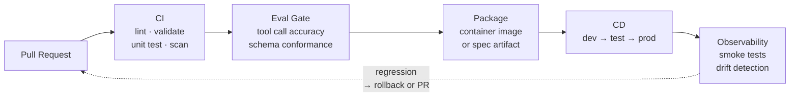
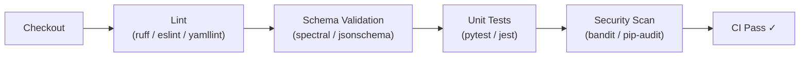
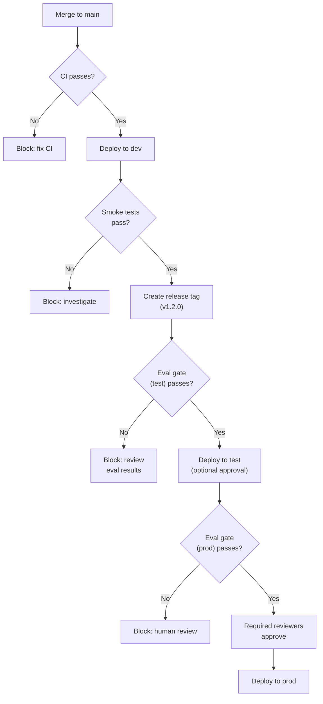

# CI/CD for Microsoft Foundry Tools

> Part of the Microsoft Foundry deployment and evaluation series for the Azure Architecture Center. See the [evaluation pipeline overview](../01-pipeline-overview/ai-eval-pipeline-overview.md) for foundational evaluation concepts, or the [agent deployment leader's guide](../07-deploy-foundry-agents/foundry-agents-deployment.md) for deployment-shape decisions.

Your Foundry agents are only as reliable as the tools they call. A broken tool signature, a regressed output schema, or a quietly degraded downstream dependency can fail every agent that depends on it — and unlike the agent logic itself, tool failures often surface silently as low evaluation scores rather than hard errors. This article gives you a repeatable, GitHub-based CI/CD pipeline to catch those failures before they reach production.

We walk through the entire lifecycle: repository structure, build and validation, evaluation gates, packaging, deployment across dev/test/prod environments with OIDC authentication, promotion governance, and post-deployment observability. Developer-focused sections include concrete GitHub Actions workflow examples; architect-facing sections focus on strategy and governance.

The running scenario throughout is the **Contoso Support Agent** from the evaluation series, and specifically its `search_knowledge_base` MCP tool — a Python-based MCP server that retrieves product documentation from Azure AI Search.

## What this article covers

| Topic | Developer sections | Architect sections |
|-------|-------------------|-------------------|
| Repository structure and source-of-truth conventions | §2 (directory layout) | §2 (mono vs multi-repo, branching strategy) |
| Tool definition formats and schema authoring | §3 | — |
| Build, lint, schema validation, unit tests, security scan | §4 | — |
| Evaluation gates before promotion | §5 | §5 (gate strategy overview) |
| Packaging and versioning (containers and specs) | §6 | — |
| Deployment with OIDC to Foundry environments | §7 | §7 (environment strategy) |
| Promotion governance and rollback | — | §8 |
| Observability and post-deployment verification | §9 (instrumentation) | §9 (metrics and drift detection) |

**Out of scope**: agent-type selection, private network topology, and Foundry project infrastructure — see the [agent deployment leader's guide](../07-deploy-foundry-agents/foundry-agents-deployment.md). Evaluator catalog and threshold tuning — see [Building AI Evaluation Pipelines on Azure](../01-pipeline-overview/ai-eval-pipeline-overview.md).

---

## 1. Introduction

Microsoft Foundry supports two categories of tools that agents can invoke:

- **MCP server tools**: code-based tool servers that implement the [Model Context Protocol](https://learn.microsoft.com/en-us/azure/foundry/agents/how-to/tools/mcp). They run as standalone processes or containers and expose one or more tools over a standardized protocol. The `search_knowledge_base` tool in our scenario is an MCP server built in Python.
- **Function-calling tools**: tools defined by an OpenAPI specification (or a Foundry-native tool spec). Foundry routes agent tool calls to the backend described in the spec. No container required — the spec is the contract.

Both categories need a CI/CD pipeline because:

1. **Tools are shared dependencies.** A single tool may be called by multiple agents across multiple projects. A silent regression cascades broadly.
2. **Schema is a contract.** Agents parse tool definitions at runtime. A schema change that breaks the contract can silently degrade agent behavior — missing required fields, wrong types, or a vanished parameter all cause tool call failures that an agent may handle poorly.
3. **Tool behavior drives evaluation scores.** The process evaluators in Foundry (tool call accuracy, tool selection, tool output utilization) measure how well agents use tools. Regressions in those scores are almost always caused by changes to the tool, not the agent.

The pipeline this article builds consists of five stages:



---

## 2. Repository structure and source-of-truth conventions

### Source-of-truth principle *(architecture)*

Every Foundry tool definition lives in Git. No manual edits to production tool registrations through the portal — all changes flow through pull requests, CI validation, and the promotion pipeline. This gives you:

- A complete audit trail of who changed what and when.
- The ability to reproduce any version of a tool at any environment.
- Automated validation before any change reaches production.

### Mono-repo vs multi-repo *(architecture)*

| Approach | When to use it | Trade-off |
|----------|---------------|-----------|
| **Mono-repo** (all tools + agents in one repo) | Small-to-medium teams; tight cross-tool dependency management; prefer atomic changes | All tools share one release cadence; large PRs; requires path-based CI filtering |
| **Multi-repo** (one repo per tool or tool group) | Large organizations; independent team ownership; tools have distinct release cycles | Cross-tool coordination requires inter-repo workflows; dependency graph harder to track |
| **Hybrid** (tools sub-directory in an agent repo) | Single-team ownership of both tool and agent; simplifies evaluation gate wiring | Harder to reuse tools across multiple agent repos |

For the Contoso Support Agent scenario, a hybrid layout works well: the tools live under `tools/` in the same repository as the agent definition. Teams with broader tool reuse should prefer a dedicated tools mono-repo.

### Branching strategy *(architecture + developer)*

Align your branching model to the three-stage environment progression (dev → test → prod):

- **`main`** is always deployable to dev. CI passes before merge.
- **Feature branches** (`feat/tool-name-change`) are the unit of work; PRs target `main`.
- **Release tags** (`v1.2.0`) trigger the CD pipeline and control what version reaches test and prod.
- **Environment promotion** is driven by the CD pipeline, not by branch merges to environment branches (avoid long-lived `staging` or `release` branches).

### Recommended directory layout *(developer)*

```
tools/
├── search-knowledge-base/          # MCP server tool (Python)
│   ├── src/
│   │   ├── server.py               # MCP server entrypoint
│   │   ├── tools/
│   │   │   └── search.py           # Tool implementation
│   │   └── models.py               # Input/output models
│   ├── tests/
│   │   ├── test_search.py          # Unit tests
│   │   └── conftest.py
│   ├── tool_manifest.json          # MCP server descriptor (endpoint, capabilities)
│   ├── Dockerfile
│   ├── pyproject.toml
│   └── README.md
├── lookup-order/                   # Function-calling tool (OpenAPI-spec-driven)
│   ├── openapi.yaml                # Tool contract — the source of truth
│   ├── tests/
│   │   └── test_schema.py          # Schema conformance tests
│   └── README.md
└── create-ticket/                  # Function-calling tool
    ├── openapi.yaml
    ├── tests/
    │   └── test_schema.py
    └── README.md
.github/
└── workflows/
    ├── tool-ci.yml                 # CI: lint, validate, test, scan
    ├── tool-eval-gate.yml          # Evaluation gate
    ├── tool-package.yml            # Package and push container / artifact
    └── tool-cd.yml                 # Deploy to dev / test / prod
```

**Key convention**: the `openapi.yaml` (or `tool_manifest.json`) is the contract. CI validates it before anything else runs. The implementation serves the contract — not the reverse.

---

## 3. Tool definition formats

### MCP server tools

An MCP server tool descriptor (`tool_manifest.json`) tells Foundry how to connect to your server and what tools it exposes:

```json
{
  "name": "search-knowledge-base",
  "version": "1.2.0",
  "description": "Searches the Contoso product knowledge base.",
  "server": {
    "transport": "http",
    "url": "${TOOL_ENDPOINT_URL}"
  },
  "capabilities": {
    "tools": ["search_knowledge_base"]
  }
}
```

The `${TOOL_ENDPOINT_URL}` placeholder is resolved at deployment time from a GitHub Actions environment variable — never hardcode environment-specific values in the manifest.

### Function-calling tools

A function-calling tool is defined by an OpenAPI 3.x document. Foundry reads this to generate the tool definition it presents to the agent. Field descriptions matter: the agent uses them to decide when and how to call the tool.

```yaml
# tools/lookup-order/openapi.yaml
openapi: "3.1.0"
info:
  title: Lookup Order
  version: "1.0.0"
  description: Retrieves order status and details from the Contoso CRM system.
paths:
  /orders/{order_id}:
    get:
      operationId: lookup_order
      summary: Look up the status of a customer order.
      description: >
        Returns current status, estimated delivery date, and last-updated timestamp
        for the specified order. Use this tool when the customer asks about an order,
        a shipment, or a delivery.
      parameters:
        - name: order_id
          in: path
          required: true
          schema:
            type: string
          description: The order identifier from the customer's account or their message.
      responses:
        "200":
          description: Order found.
          content:
            application/json:
              schema:
                $ref: "#/components/schemas/OrderStatus"
        "404":
          description: Order not found.
components:
  schemas:
    OrderStatus:
      type: object
      required: [order_id, status]
      properties:
        order_id:
          type: string
        status:
          type: string
          enum: [pending, processing, shipped, delivered, cancelled]
        estimated_delivery:
          type: string
          format: date
        last_updated:
          type: string
          format: date-time
```

### Versioning

Use **semantic versioning** (`MAJOR.MINOR.PATCH`):

| Change | Version bump | Example |
|--------|-------------|---------|
| New required parameter, renamed field, removed field | `MAJOR` | `1.0.0` → `2.0.0` |
| New optional parameter, new response field | `MINOR` | `1.0.0` → `1.1.0` |
| Bug fix, documentation update, description improvement | `PATCH` | `1.0.0` → `1.0.1` |

A `MAJOR` bump on a shared tool means every agent that uses it needs to be updated. Treat this as a breaking change and coordinate the rollout across dependent agents.

Tag releases in Git: `git tag -a v1.2.0 -m "search-knowledge-base v1.2.0"`. The CD pipeline triggers from these tags.

---

## 4. Build and validation pipeline

The CI workflow runs on every pull request targeting `main`. Its job is to fail fast on any change that would break the tool's contract, correctness, or security posture.



### CI workflow (`tool-ci.yml`)

```yaml
# .github/workflows/tool-ci.yml
name: Tool CI

on:
  pull_request:
    paths:
      - "tools/**"
      - ".github/workflows/tool-ci.yml"

jobs:
  ci:
    name: Lint, Validate, Test, Scan
    runs-on: ubuntu-latest
    strategy:
      matrix:
        tool:
          - search-knowledge-base
          - lookup-order
          - create-ticket

    steps:
      - name: Checkout
        uses: actions/checkout@v4

      # ── Python MCP tools ──────────────────────────────────────────────────
      - name: Set up Python
        if: hashFiles(format('tools/{0}/pyproject.toml', matrix.tool)) != ''
        uses: actions/setup-python@v5
        with:
          python-version: "3.12"
          cache: pip

      - name: Install Python dependencies
        if: hashFiles(format('tools/{0}/pyproject.toml', matrix.tool)) != ''
        run: |
          pip install --upgrade pip
          pip install -e "tools/${{ matrix.tool }}[dev]"

      - name: Lint (ruff)
        if: hashFiles(format('tools/{0}/pyproject.toml', matrix.tool)) != ''
        run: ruff check tools/${{ matrix.tool }}/src tools/${{ matrix.tool }}/tests

      - name: Unit tests (pytest)
        if: hashFiles(format('tools/{0}/pyproject.toml', matrix.tool)) != ''
        run: pytest tools/${{ matrix.tool }}/tests -v --tb=short

      - name: Security scan (bandit)
        if: hashFiles(format('tools/{0}/pyproject.toml', matrix.tool)) != ''
        run: bandit -r tools/${{ matrix.tool }}/src -ll

      - name: Dependency audit (pip-audit)
        if: hashFiles(format('tools/{0}/pyproject.toml', matrix.tool)) != ''
        run: pip-audit --requirement tools/${{ matrix.tool }}/requirements.txt

      # ── OpenAPI / spec-driven tools ───────────────────────────────────────
      - name: Set up Node (for Spectral)
        if: hashFiles(format('tools/{0}/openapi.yaml', matrix.tool)) != ''
        uses: actions/setup-node@v4
        with:
          node-version: "20"

      - name: Install Spectral
        if: hashFiles(format('tools/{0}/openapi.yaml', matrix.tool)) != ''
        run: npm install -g @stoplight/spectral-cli

      - name: Lint OpenAPI spec (Spectral)
        if: hashFiles(format('tools/{0}/openapi.yaml', matrix.tool)) != ''
        run: spectral lint tools/${{ matrix.tool }}/openapi.yaml --ruleset @stoplight/spectral-oas

      - name: YAML lint
        run: |
          pip install yamllint
          yamllint tools/${{ matrix.tool }}
```

**Keeping CI fast**: the matrix runs each tool in parallel. Target total wall-clock time under three minutes. If a tool's unit tests grow beyond that, split integration tests into the evaluation gate (§5) where they can run against real Azure resources.

### Unit test conventions

Unit tests for tool implementations should mock all external dependencies (Azure SDK clients, HTTP calls, database connections) so they run offline and fast:

```python
# tools/search-knowledge-base/tests/test_search.py
from unittest.mock import AsyncMock, patch
import pytest
from tools.search import search_knowledge_base

@pytest.mark.asyncio
async def test_search_returns_results_on_hit():
    mock_results = [
        {"id": "doc-1", "content": "Reset your password at contoso.com/reset", "score": 0.95}
    ]
    with patch("tools.search.SearchClient") as MockClient:
        instance = MockClient.return_value
        instance.search = AsyncMock(return_value=mock_results)
        result = await search_knowledge_base(query="how do I reset my password")
    assert len(result["results"]) == 1
    assert result["results"][0]["score"] == pytest.approx(0.95)

@pytest.mark.asyncio
async def test_search_returns_empty_on_miss():
    with patch("tools.search.SearchClient") as MockClient:
        instance = MockClient.return_value
        instance.search = AsyncMock(return_value=[])
        result = await search_knowledge_base(query="zzz nonexistent query zzz")
    assert result["results"] == []
```

---

## 5. Evaluation gates before promotion

Unit tests verify that individual functions behave correctly in isolation. Evaluation gates verify that **the tool behaves correctly when an agent uses it** — catching semantic regressions like a response structure that subtly misleads the agent, or a search ranking change that causes the agent to cite the wrong document.

### Gate strategy *(architecture)*

| Promotion | Gate | Evaluators | Threshold |
|-----------|------|------------|-----------|
| Dev → Test | Lightweight eval on a 10–20 row golden dataset | Tool call accuracy, output schema conformance | ≥ 0.80 accuracy |
| Test → Prod | Full eval on 100+ row dataset | Tool call accuracy, tool selection, tool output utilization, safety | ≥ 0.90 accuracy; ≥ 0.85 utilization; 0 safety violations |

The evaluation gate sits between the packaging step and the environment deployment in the CD pipeline. If the gate fails, the workflow blocks the deployment and posts results to the PR or deployment summary.

### Evaluation gate workflow (`tool-eval-gate.yml`)

```yaml
# .github/workflows/tool-eval-gate.yml
name: Tool Evaluation Gate

on:
  workflow_call:
    inputs:
      environment:
        required: true
        type: string          # "test" or "prod"
      tool_endpoint_url:
        required: true
        type: string
      dataset_path:
        required: true
        type: string          # e.g. "tools/search-knowledge-base/evals/golden_set_test.jsonl"

permissions:
  id-token: write             # Required for OIDC
  contents: read

jobs:
  eval-gate:
    name: Evaluation Gate (${{ inputs.environment }})
    runs-on: ubuntu-latest
    environment: ${{ inputs.environment }}

    steps:
      - name: Checkout
        uses: actions/checkout@v4

      - name: Azure Login (OIDC)
        uses: azure/login@v2
        with:
          client-id: ${{ secrets.AZURE_CLIENT_ID }}
          tenant-id: ${{ secrets.AZURE_TENANT_ID }}
          subscription-id: ${{ secrets.AZURE_SUBSCRIPTION_ID }}

      - name: Set up Python
        uses: actions/setup-python@v5
        with:
          python-version: "3.12"
          cache: pip

      - name: Install evaluation dependencies
        run: pip install azure-ai-evaluation azure-identity

      - name: Run evaluation gate
        id: eval
        env:
          AZURE_AI_PROJECT_ENDPOINT: ${{ secrets.AZURE_AI_PROJECT_ENDPOINT }}
          TOOL_ENDPOINT_URL: ${{ inputs.tool_endpoint_url }}
          DATASET_PATH: ${{ inputs.dataset_path }}
          ENVIRONMENT: ${{ inputs.environment }}
        run: python .github/scripts/run_tool_eval_gate.py

      - name: Upload evaluation report
        if: always()
        uses: actions/upload-artifact@v4
        with:
          name: eval-report-${{ inputs.environment }}
          path: eval_results/
```

The gate script invokes the evaluation SDK, checks thresholds, and exits non-zero on failure:

```python
# .github/scripts/run_tool_eval_gate.py
import json
import os
import sys
from pathlib import Path

from azure.ai.evaluation import evaluate, ToolCallAccuracyEvaluator
from azure.identity import DefaultAzureCredential

THRESHOLDS = {
    "test": {"tool_call_accuracy": 0.80},
    "prod": {"tool_call_accuracy": 0.90, "tool_output_utilization": 0.85},
}

environment = os.environ["ENVIRONMENT"]
project_endpoint = os.environ["AZURE_AI_PROJECT_ENDPOINT"]
dataset_path = os.environ["DATASET_PATH"]

credential = DefaultAzureCredential()
model_config = {
    "azure_endpoint": project_endpoint,
    "azure_deployment": "gpt-4o",
}

results = evaluate(
    data=dataset_path,
    evaluators={
        "tool_call_accuracy": ToolCallAccuracyEvaluator(model_config=model_config),
    },
    output_path="eval_results/",
)

summary = results["metrics"]
thresholds = THRESHOLDS[environment]
failures = []

for metric, threshold in thresholds.items():
    score = summary.get(f"tool_call_accuracy.{metric}", summary.get(metric, 0.0))
    if score < threshold:
        failures.append(f"{metric}: {score:.2f} < required {threshold:.2f}")

if failures:
    print("❌ Evaluation gate FAILED:")
    for f in failures:
        print(f"  {f}")
    sys.exit(1)

print("✅ Evaluation gate PASSED:")
for metric, threshold in thresholds.items():
    score = summary.get(f"tool_call_accuracy.{metric}", summary.get(metric, 0.0))
    print(f"  {metric}: {score:.2f} (threshold: {threshold:.2f})")
```

> **Preview notice**: `ToolCallAccuracyEvaluator` and the process evaluators that score tool behavior are in preview. Flag gate failures for human review during the preview period rather than treating them as fully automated hard blocks.

Cross-reference: see [Building AI Evaluation Pipelines on Azure](../01-pipeline-overview/ai-eval-pipeline-overview.md) for the full evaluator catalog, threshold guidance, and golden dataset design patterns.

---

## 6. Packaging and versioning

### MCP server tools (containerized)

Build a container image and push it to Azure Container Registry. Use **immutable version tags** (`v1.2.0`) for production images, not `latest`.

```yaml
# .github/workflows/tool-package.yml  (relevant steps)
- name: Azure Login (OIDC)
  uses: azure/login@v2
  with:
    client-id: ${{ secrets.AZURE_CLIENT_ID }}
    tenant-id: ${{ secrets.AZURE_TENANT_ID }}
    subscription-id: ${{ secrets.AZURE_SUBSCRIPTION_ID }}

- name: Log in to Azure Container Registry
  run: az acr login --name ${{ secrets.ACR_NAME }}

- name: Build and push container image
  env:
    IMAGE: ${{ secrets.ACR_NAME }}.azurecr.io/tools/search-knowledge-base
    VERSION: ${{ github.ref_name }}       # e.g. v1.2.0
    SHA_TAG: ${{ github.sha }}
  run: |
    docker build \
      --tag "${IMAGE}:${VERSION}" \
      --tag "${IMAGE}:${SHA_TAG}" \
      --label "org.opencontainers.image.version=${VERSION}" \
      --label "org.opencontainers.image.revision=${SHA_TAG}" \
      tools/search-knowledge-base/
    docker push "${IMAGE}:${VERSION}"
    docker push "${IMAGE}:${SHA_TAG}"
```

**Container hygiene checklist**:
- Use a distroless or minimal base image (`python:3.12-slim` at minimum; `gcr.io/distroless/python3` for production).
- Run as a non-root user (`USER nonroot` in the Dockerfile).
- No secrets baked into the image — resolve at runtime via environment variables or managed identity token acquisition.
- Enable `DOCKER_BUILDKIT=1` for layer caching in CI.

### Function-calling tools (spec artifacts)

The artifact for a spec-driven tool is the validated `openapi.yaml` file. Publish it as a GitHub Release asset so you have an immutable, versioned store:

```yaml
- name: Create GitHub Release with spec artifact
  uses: softprops/action-gh-release@v2
  with:
    tag_name: ${{ github.ref_name }}
    files: |
      tools/lookup-order/openapi.yaml
      tools/create-ticket/openapi.yaml
```

---

## 7. Deployment to Foundry environments

### OIDC / federated credentials — setup *(developer)*

Never use long-lived client secrets for GitHub Actions → Azure authentication. Use **OIDC federated credentials**:

1. **Create an app registration** in Microsoft Entra ID (or use a user-assigned managed identity).
2. **Add a federated credential** for each GitHub environment:
   - Issuer: `https://token.actions.githubusercontent.com`
   - Subject: `repo:YOUR-ORG/YOUR-REPO:environment:prod` (adjust per environment)
   - Audience: `api://AzureADTokenExchange`
3. **Grant the app registration the required roles**:
   - `Azure AI Developer` on the Foundry project (to register and update tool connections).
   - `AcrPush` on the Azure Container Registry (for containerized tools).
   - `Reader` on the resource group (for `az` CLI operations).

The subject claim format lets you scope credentials tightly. Use separate federated credentials for `dev`, `test`, and `prod` environments so a compromised dev workflow cannot deploy to production.

```bash
# One-time setup (run as a user with Owner or User Access Administrator on the subscription)
APP_ID=$(az ad app create --display-name "foundry-tools-cicd" --query appId -o tsv)
az ad sp create --id $APP_ID

# Federated credential for the prod environment
az ad app federated-credential create \
  --id $APP_ID \
  --parameters '{
    "name": "github-prod",
    "issuer": "https://token.actions.githubusercontent.com",
    "subject": "repo:contoso/support-agent:environment:prod",
    "audiences": ["api://AzureADTokenExchange"]
  }'

# Grant roles
az role assignment create \
  --assignee $APP_ID \
  --role "Azure AI Developer" \
  --scope /subscriptions/$SUB/resourceGroups/$RG/providers/Microsoft.CognitiveServices/accounts/$FOUNDRY_PROJECT
```

Store `APP_ID` (as `AZURE_CLIENT_ID`), the tenant ID (as `AZURE_TENANT_ID`), and the subscription ID (as `AZURE_SUBSCRIPTION_ID`) as GitHub Actions secrets scoped to the appropriate environment.

### Environment strategy *(architecture)*

Use GitHub Actions **environments** with protection rules aligned to your promotion policy:

| GitHub environment | Foundry environment | Deployment trigger | Approval required |
|-------------------|--------------------|--------------------|-------------------|
| `dev` | Dev Foundry project | Merge to `main` | None |
| `test` | Test Foundry project | Git tag `v*` pushed to `main` | Optional (team lead) |
| `prod` | Prod Foundry project | Manual workflow trigger after eval gate passes | Required (2 reviewers) |

Environment protection rules enforce:
- Required reviewers for `test` and `prod`.
- Deployment branch restriction: only `main` can deploy to `test` and `prod`.
- Wait timer: a 5–10 minute delay on `prod` deployments gives teams time to cancel before infrastructure changes take effect.

### CD workflow (`tool-cd.yml`)

```yaml
# .github/workflows/tool-cd.yml
name: Tool CD

on:
  push:
    tags:
      - "v*"             # CD triggers on versioned tags

permissions:
  id-token: write
  contents: read

jobs:
  # ── 1. Package ─────────────────────────────────────────────────────────────
  package:
    name: Package
    runs-on: ubuntu-latest
    outputs:
      image_tag: ${{ steps.meta.outputs.version }}
    steps:
      - uses: actions/checkout@v4
      - name: Azure Login (OIDC)
        uses: azure/login@v2
        with:
          client-id: ${{ secrets.AZURE_CLIENT_ID }}
          tenant-id: ${{ secrets.AZURE_TENANT_ID }}
          subscription-id: ${{ secrets.AZURE_SUBSCRIPTION_ID }}
      - name: Log in to ACR
        run: az acr login --name ${{ secrets.ACR_NAME }}
      - id: meta
        run: echo "version=${GITHUB_REF_NAME}" >> "$GITHUB_OUTPUT"
      - name: Build and push image
        env:
          IMAGE: ${{ secrets.ACR_NAME }}.azurecr.io/tools/search-knowledge-base
        run: |
          docker build -t "${IMAGE}:${{ steps.meta.outputs.version }}" \
                       -t "${IMAGE}:${{ github.sha }}" \
                       tools/search-knowledge-base/
          docker push "${IMAGE}:${{ steps.meta.outputs.version }}"
          docker push "${IMAGE}:${{ github.sha }}"

  # ── 2. Deploy to dev ────────────────────────────────────────────────────────
  deploy-dev:
    name: Deploy → dev
    needs: package
    runs-on: ubuntu-latest
    environment: dev
    steps:
      - uses: actions/checkout@v4
      - name: Azure Login (OIDC)
        uses: azure/login@v2
        with:
          client-id: ${{ secrets.AZURE_CLIENT_ID }}
          tenant-id: ${{ secrets.AZURE_TENANT_ID }}
          subscription-id: ${{ secrets.AZURE_SUBSCRIPTION_ID }}
      - name: Deploy tool to dev Foundry project
        env:
          FOUNDRY_PROJECT_ENDPOINT: ${{ secrets.FOUNDRY_PROJECT_ENDPOINT }}
          IMAGE_TAG: ${{ needs.package.outputs.image_tag }}
        run: python .github/scripts/deploy_tool.py --environment dev --image-tag "$IMAGE_TAG"
      - name: Smoke test
        env:
          TOOL_ENDPOINT: ${{ secrets.TOOL_ENDPOINT_URL }}
        run: python .github/scripts/smoke_test.py --endpoint "$TOOL_ENDPOINT"

  # ── 3. Eval gate + deploy to test ──────────────────────────────────────────
  eval-gate-test:
    name: Evaluation Gate (test)
    needs: deploy-dev
    uses: ./.github/workflows/tool-eval-gate.yml
    with:
      environment: test
      tool_endpoint_url: ${{ vars.TOOL_ENDPOINT_URL_DEV }}
      dataset_path: tools/search-knowledge-base/evals/golden_set_test.jsonl
    secrets: inherit

  deploy-test:
    name: Deploy → test
    needs: eval-gate-test
    runs-on: ubuntu-latest
    environment: test
    steps:
      - uses: actions/checkout@v4
      - name: Azure Login (OIDC)
        uses: azure/login@v2
        with:
          client-id: ${{ secrets.AZURE_CLIENT_ID }}
          tenant-id: ${{ secrets.AZURE_TENANT_ID }}
          subscription-id: ${{ secrets.AZURE_SUBSCRIPTION_ID }}
      - name: Deploy tool to test Foundry project
        env:
          FOUNDRY_PROJECT_ENDPOINT: ${{ secrets.FOUNDRY_PROJECT_ENDPOINT }}
          IMAGE_TAG: ${{ needs.package.outputs.image_tag }}
        run: python .github/scripts/deploy_tool.py --environment test --image-tag "$IMAGE_TAG"
      - name: Smoke test
        env:
          TOOL_ENDPOINT: ${{ secrets.TOOL_ENDPOINT_URL }}
        run: python .github/scripts/smoke_test.py --endpoint "$TOOL_ENDPOINT"

  # ── 4. Eval gate + deploy to prod ──────────────────────────────────────────
  eval-gate-prod:
    name: Evaluation Gate (prod)
    needs: deploy-test
    uses: ./.github/workflows/tool-eval-gate.yml
    with:
      environment: prod
      tool_endpoint_url: ${{ vars.TOOL_ENDPOINT_URL_TEST }}
      dataset_path: tools/search-knowledge-base/evals/golden_set_prod.jsonl
    secrets: inherit

  deploy-prod:
    name: Deploy → prod
    needs: eval-gate-prod
    runs-on: ubuntu-latest
    environment: prod                   # Requires human approval via environment protection
    steps:
      - uses: actions/checkout@v4
      - name: Azure Login (OIDC)
        uses: azure/login@v2
        with:
          client-id: ${{ secrets.AZURE_CLIENT_ID }}
          tenant-id: ${{ secrets.AZURE_TENANT_ID }}
          subscription-id: ${{ secrets.AZURE_SUBSCRIPTION_ID }}
      - name: Deploy tool to prod Foundry project
        env:
          FOUNDRY_PROJECT_ENDPOINT: ${{ secrets.FOUNDRY_PROJECT_ENDPOINT }}
          IMAGE_TAG: ${{ needs.package.outputs.image_tag }}
        run: python .github/scripts/deploy_tool.py --environment prod --image-tag "$IMAGE_TAG"
      - name: Smoke test
        env:
          TOOL_ENDPOINT: ${{ secrets.TOOL_ENDPOINT_URL }}
        run: python .github/scripts/smoke_test.py --endpoint "$TOOL_ENDPOINT"
```

### Deploying the tool connection via the SDK *(developer)*

The `deploy_tool.py` script registers or updates the MCP tool connection in the target Foundry project:

```python
# .github/scripts/deploy_tool.py
import argparse
import os
from azure.ai.projects import AIProjectClient
from azure.identity import DefaultAzureCredential

def deploy_tool(environment: str, image_tag: str) -> None:
    endpoint = os.environ["FOUNDRY_PROJECT_ENDPOINT"]
    client = AIProjectClient(endpoint=endpoint, credential=DefaultAzureCredential())

    connection_name = f"search-knowledge-base-{environment}"
    tool_url = f"https://tools.{environment}.contoso.internal/search-knowledge-base"

    # Upsert the tool connection — safe to re-run
    client.connections.create_or_update(
        connection_name=connection_name,
        connection_type="mcp",
        endpoint=tool_url,
        metadata={
            "image_tag": image_tag,
            "environment": environment,
        },
    )
    print(f"✅ Tool connection '{connection_name}' updated to image {image_tag}")

if __name__ == "__main__":
    parser = argparse.ArgumentParser()
    parser.add_argument("--environment", required=True)
    parser.add_argument("--image-tag", required=True)
    args = parser.parse_args()
    deploy_tool(args.environment, args.image_tag)
```

> **Note**: The `connections.create_or_update` method and its exact parameters depend on the version of `azure-ai-projects` you are using. Verify against the [SDK samples](https://github.com/Azure/azure-sdk-for-python/tree/main/sdk/ai/azure-ai-projects/samples) at time of implementation.

---

## 8. Promotion strategy and rollback *(architecture)*

### Promotion governance

A promotion event should be a deliberate, documented decision — not an automatic side effect of a passing test. Build your promotion criteria into the pipeline as explicit checkpoints:



**Promotion criteria summary**:

| Stage | Gate | Human approval |
|-------|------|---------------|
| Dev | CI (lint, validate, unit test, security scan) | None |
| Test | Dev smoke tests pass; lightweight eval gate ≥ threshold | Optional |
| Prod | Full eval gate ≥ threshold; no safety violations; change documented | Required (2 reviewers) |

### Rollback

Rollback is a re-deployment of the last known-good version — not a code revert. Keep the last three production image tags and spec versions accessible in ACR and GitHub Releases so rollback is a single workflow run:

1. **Trigger**: On-call engineer manually triggers the rollback workflow with the target version tag as input.
2. **Action**: The CD pipeline's deploy-to-prod job runs with the previous version tag, skipping the eval gate (rollback speed takes priority over gating).
3. **Verification**: Smoke tests run against production to confirm the rollback succeeded.
4. **Post-incident**: A follow-up PR documents the root cause, adds a regression test, and re-runs the full promotion pipeline before re-deploying the rolled-back version.

### Version skew between tools and agents

When a tool's `MAJOR` version increments, dependent agents must be updated to use the new version. Coordinate this rollout:

1. Deploy the new tool version to dev and test environments alongside the current version (use different connection names: `search-knowledge-base-v1`, `search-knowledge-base-v2`).
2. Update the agent definition to reference the new connection and run agent-level evaluation.
3. Promote both the new tool version and the updated agent definition to prod together.
4. Decommission the old tool connection after confirming no agent references it.

---

## 9. Observability and post-deployment verification

### Smoke tests *(developer)*

Every deploy step ends with a smoke test — a small set of known inputs with expected outputs, invoked directly against the deployed tool endpoint:

```python
# .github/scripts/smoke_test.py
import argparse
import sys
import httpx

SMOKE_CASES = [
    {
        "input": {"query": "how to reset password"},
        "expect_non_empty": True,
    },
    {
        "input": {"query": "zzz_nonexistent_zzz_12345"},
        "expect_non_empty": False,
    },
]

def run_smoke_tests(endpoint: str) -> None:
    failures = []
    with httpx.Client(timeout=10.0) as client:
        for case in SMOKE_CASES:
            response = client.post(f"{endpoint}/search_knowledge_base", json=case["input"])
            response.raise_for_status()
            data = response.json()
            has_results = len(data.get("results", [])) > 0
            if has_results != case["expect_non_empty"]:
                failures.append(
                    f"Input {case['input']!r}: expected non_empty={case['expect_non_empty']}, "
                    f"got {has_results}"
                )

    if failures:
        print("❌ Smoke tests FAILED:")
        for f in failures:
            print(f"  {f}")
        sys.exit(1)
    print(f"✅ Smoke tests passed ({len(SMOKE_CASES)} cases)")

if __name__ == "__main__":
    parser = argparse.ArgumentParser()
    parser.add_argument("--endpoint", required=True)
    args = parser.parse_args()
    run_smoke_tests(args.endpoint)
```

### Instrumentation for MCP tool servers *(developer)*

Wire your tool implementation to Application Insights using the Azure Monitor OpenTelemetry distro. Emit a structured log entry per tool call with a correlation key so you can trace tool invocations back to agent conversations:

```python
# tools/search-knowledge-base/src/server.py  (instrumentation excerpt)
import os
from azure.monitor.opentelemetry import configure_azure_monitor
from opentelemetry import trace

configure_azure_monitor(
    connection_string=os.environ["APPLICATIONINSIGHTS_CONNECTION_STRING"]
)
tracer = trace.get_tracer("search-knowledge-base")

async def search_knowledge_base(query: str, tool_call_id: str | None = None) -> dict:
    with tracer.start_as_current_span("search_knowledge_base") as span:
        span.set_attribute("tool.call_id", tool_call_id or "")
        span.set_attribute("tool.query", query)
        # ... implementation ...
        span.set_attribute("tool.result_count", len(results))
        return {"results": results}
```

Set `APPLICATIONINSIGHTS_CONNECTION_STRING` as a GitHub Actions secret and inject it into the container at deploy time.

### Metrics and drift detection *(developer + architecture)*

Track the following signals in Application Insights / Log Analytics:

| Metric | Description | Alert threshold |
|--------|-------------|----------------|
| `tool_call_latency_ms` (p50/p95/p99) | End-to-end tool call latency | p99 > 3000 ms |
| `tool_error_rate` | Fraction of tool calls returning errors | > 2% |
| `tool_schema_validation_failure_rate` | Fraction of responses failing output schema validation | > 0% |
| `tool_call_accuracy` (from scheduled eval) | Evaluation score from the nightly eval run | < 0.85 |

Run the evaluation gate on a **nightly schedule** against a sample of recent production tool calls to detect drift. A score drop that crosses the threshold should page the on-call engineer:

```yaml
# Addition to tool-eval-gate.yml — scheduled drift detection
on:
  schedule:
    - cron: "0 2 * * *"   # 02:00 UTC daily
  workflow_call:
    # ... (existing inputs for on-demand use)
```

### Foundry observability integration *(architecture)*

Foundry's built-in observability features (see [Foundry observability docs](https://learn.microsoft.com/en-us/azure/foundry/concepts/observability)) trace agent conversations end-to-end, including tool calls. When your tool emits OpenTelemetry spans, those spans appear in Foundry's trace view alongside the agent's reasoning steps, giving you a correlated view from user query to final response.

Post-deployment verification checklist for each production deploy:

- [ ] Smoke tests pass.
- [ ] No spike in `tool_error_rate` in the 30 minutes after deployment.
- [ ] Tool traces visible in Foundry portal for the new version.
- [ ] p95 latency within baseline ± 20%.
- [ ] No new `tool_schema_validation_failure_rate` events.

---

## 10. Where to go next

| Resource | What it covers |
|----------|----------------|
| [Building AI Evaluation Pipelines on Azure](../01-pipeline-overview/ai-eval-pipeline-overview.md) | Evaluator catalog, threshold guidance, environment progression — foundational concepts for the evaluation gate in §5 |
| [Reference Architecture for Agent Evaluation](../02-ref-architecture/ai-eval-ref-architecture.md) | How tools fit in the broader agent evaluation topology; golden dataset design |
| [Deploying Microsoft Foundry Agents — A Leader's Guide](../07-deploy-foundry-agents/foundry-agents-deployment.md) | Agent deployment shape, private networking, identity governance — strategic context for tool deployment decisions |
| [Deploying Foundry Hosted Agents — A Developer's Guide](../07-deploy-foundry-agents/hosted-agents-developer-guide.md) | Versioned agent endpoints and canary routing — coordinates with the tool version skew guidance in §8 |
| [Microsoft Foundry tools documentation](https://learn.microsoft.com/en-us/azure/foundry/agents/concepts/tools-overview) | Current tool schema, MCP server requirements, function-calling tool spec reference |
| [GitHub Actions OIDC with Azure](https://learn.microsoft.com/en-us/azure/developer/github/connect-from-azure-openid-connect) | Detailed OIDC federation setup and troubleshooting |
| [azure-ai-evaluation SDK](https://learn.microsoft.com/en-us/azure/foundry/how-to/develop/evaluate-sdk) | Evaluation SDK reference for custom gate implementations |
