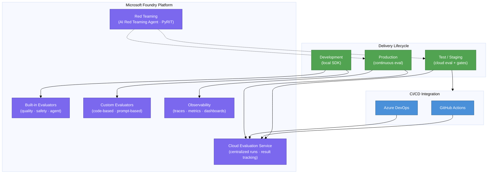

# AI Evaluation Strategy for Technical Leaders

> Series introduction — start here if you're designing an AI evaluation practice for your organization. This article provides strategic context for IT technical leaders and architects. The companion articles in this series deliver the hands-on implementation details.

## Why AI evaluation is a leadership concern

Traditional software either works or it doesn't. Your API returns the right data or throws an error. Your business logic calculates the correct total or fails a unit test. AI applications break that model. A language model can return a confident, well-structured response that is completely wrong. An agent can call the right tools in the wrong order. A chatbot can produce a helpful answer to 999 users and a harmful one to the 1,000th.

These failures are *probabilistic*, not deterministic. You can't catch them with unit tests or integration tests alone. You need a different kind of quality assurance — one designed for outputs that vary, that can be subtly wrong, and that carry safety and reputational risk when they fail.

**AI evaluation** is the systematic practice of measuring whether your AI application's outputs meet defined quality, safety, and task-completion criteria. It uses specialized scoring — both automated and human — to assess how well your application performs across representative scenarios. Done well, evaluation becomes a continuous practice embedded in your delivery lifecycle, not a one-time checkbox before launch.

### The cost of not evaluating

Organizations that skip systematic evaluation expose themselves to three categories of risk:

- **Reputational** — A customer-facing AI that hallucinates medical advice, fabricates order details, or produces offensive content damages trust in ways that are difficult to recover from.
- **Regulatory** — Emerging AI regulations and frameworks (the EU AI Act, the [NIST AI Risk Management Framework](https://www.nist.gov/itl/ai-risk-management-framework)) increasingly require documented evidence that AI systems have been systematically tested for quality and safety. "We tried it a few times and it seemed fine" isn't audit-ready.
- **Operational** — Without evaluation baselines, you have no way to detect quality drift over time. Model updates, data changes, or shifting user patterns can silently degrade your application's performance. By the time users complain, the damage is done.

Evaluation pipelines provide the quantitative evidence you need to make informed deployment decisions, satisfy governance requirements, and catch degradation before users do.

## What you're actually measuring

AI evaluation isn't a single activity — it's a family of measurement techniques, each designed to catch a different class of failure. For planning purposes, think in four categories:

### Evaluation categories

| Category | What it measures | Business question it answers | Applies to |
|----------|-----------------|------------------------------|------------|
| **Response quality** | Accuracy, coherence, fluency, groundedness of generated text | Are our AI outputs factually correct and well-written? | All AI applications |
| **Task completion** | Whether agents follow instructions, select the right tools, and complete user requests | Does our agent actually do what users ask? | Agents and copilots |
| **Safety and content risks** | Presence of harmful, biased, violent, sexual, or self-harm content in outputs | Could our application produce content that harms users or violates policy? | All AI applications |
| **Adversarial resilience** | Resistance to prompt injection, jailbreaks, and manipulation attempts | Can bad actors make our application behave in unintended ways? | All AI applications (especially customer-facing) |

### Which categories matter for your application?

Not every application needs the same depth of evaluation. Use this matrix to scope your initial evaluation strategy:

| Application type | Response quality | Task completion | Safety & content risks | Adversarial resilience |
|-----------------|:---:|:---:|:---:|:---:|
| **RAG application** | ●●● | — | ●●● | ●●○ |
| **Agent / Copilot** | ●●○ | ●●● | ●●● | ●●● |
| **Model endpoint** | ●●● | — | ●●○ | ●○○ |
| **Internal productivity tool** | ●●○ | ●○○ | ●○○ | ●○○ |

**●●●** Critical — include from day one &nbsp;|&nbsp; **●●○** Important — include before production &nbsp;|&nbsp; **●○○** Recommended — include as you mature &nbsp;|&nbsp; **—** Not applicable

Customer-facing agent applications need the deepest evaluation coverage. Internal productivity tools can start lighter and expand over time. The key insight: **every AI application needs at least quality and safety evaluation before going to production**.

### Recommended evaluator bundles by scenario

| Scenario | Recommended evaluators | When to add |
|----------|----------------------|-------------|
| RAG app, external users | Quality (coherence, groundedness, relevance) + safety + periodic red teaming | Day one |
| Agent with tool use | Task adherence + tool accuracy + tool selection + safety + red teaming | Day one |
| Internal assistant | Quality (coherence, fluency) + core safety (violence, hate) | Day one; expand to full safety + red teaming before wider rollout |
| Model endpoint (API) | Quality (coherence, groundedness) + safety | Day one; add red teaming before customer-facing use |

## Designing your evaluation strategy

### Start with your risk profile

Your evaluation depth should match your application's risk. A customer-facing healthcare agent that provides medication guidance needs rigorous, multi-layered evaluation with strict safety thresholds and human review gates. An internal document summarization tool for your engineering team needs solid quality evaluation but can tolerate more relaxed safety thresholds.

Ask these questions to calibrate your approach:

- **Who interacts with this application?** External customers require stricter quality and safety bars than internal users.
- **What's the cost of a wrong answer?** Financial transactions, medical advice, and legal guidance demand higher groundedness and accuracy thresholds than casual search.
- **Is the application autonomous or supervised?** Agents that take actions (creating tickets, placing orders) need stronger task-completion and tool-accuracy evaluation than assistants that only generate text for human review.
- **What regulatory requirements apply?** Healthcare, financial services, and applications deployed in EU jurisdictions may have specific documentation and testing requirements.

### Define your quality bar

Evaluation produces numerical scores. Someone needs to decide what scores are "good enough." This is a business decision, not a technical one.

- **Quality evaluators** score on a 1–5 scale (coherence, fluency, groundedness, relevance). A threshold of 4.0 means you accept responses that are occasionally imperfect. A threshold of 4.5 means you demand near-perfection.
- **Safety evaluators** score on a 0–7 severity scale. Most organizations set the threshold at 3 — anything at or above severity 3 is flagged as a defect. For high-risk applications, you may lower this to 1.
- **Agent evaluators** produce binary pass/fail results per interaction. You set a *pass rate* threshold — for example, "tool selection must pass on at least 90% of test cases."

> **Who owns the quality bar?** This decision shouldn't live solely with the development team. Product owners, compliance teams, and business stakeholders should participate in setting thresholds — especially for safety and high-stakes applications.

### Plan your dataset strategy

Evaluation is only as good as the data you evaluate against. A **golden dataset** is a curated set of representative inputs (and optionally expected outputs) that your evaluation pipeline runs against consistently.

Effective golden datasets:

- **Represent your real users** — cover the query types, domains, and edge cases your application encounters in production
- **Include adversarial cases** — queries designed to probe safety boundaries and expose prompt injection vulnerabilities
- **Are versioned** — every change is tracked so you can compare evaluation results across dataset versions
- **Grow over time** — production incidents, safety findings, and red-team discoveries feed back into the dataset as new test cases

Start with 50 rows for development iteration. Scale to 100+ for pre-production gates. Plan for 500+ as your application matures and your understanding of failure modes deepens.

### Establish ownership

Evaluation pipelines cross organizational boundaries. Clarify roles early:

| Role | Responsibility |
|------|---------------|
| **AI/ML engineers** | Build and maintain the evaluation pipeline; select and configure evaluators |
| **Product owners** | Define quality thresholds and acceptance criteria in collaboration with engineering |
| **Security / Responsible AI** | Set safety thresholds, review red-teaming results, own the safety gate |
| **DevOps / Platform** | Integrate evaluation into CI/CD, manage infrastructure, maintain environments |
| **Leadership** | Fund the evaluation practice, review governance dashboards, own go/no-go decisions for high-risk applications |

## Evaluation across the delivery lifecycle

Evaluation isn't a single gate — it's a series of checkpoints across your entire delivery pipeline. Each environment serves a different purpose, and the evaluation approach should match.

```mermaid
%%{init: {'theme': 'base', 'themeVariables': {'fontSize': '14px'}}}%%
graph LR
    subgraph Dev["Development"]
        D1["Small dataset<br/>(10–50 rows)"]
        D2["Quality evaluators"]
        D3["Safety smoke test"]
        D4["Fast feedback<br/>(seconds–minutes)"]
    end

    subgraph Test["Test / Staging"]
        T1["Full dataset<br/>(100+ rows)"]
        T2["All evaluator types"]
        T3["Automated CI/CD gates"]
        T4["Statistical confidence"]
        T5["Human review for<br/>high-risk apps"]
    end

    subgraph Prod["Production"]
        P1["Sampled live traffic"]
        P2["Continuous evaluation"]
        P3["Drift detection<br/>and alerting"]
        P4["Safety incident<br/>response"]
        P5["Periodic red<br/>teaming"]
    end

    Dev -- "quality gate<br/>passed" --> Test
    Test -- "full gate passed<br/>+ human review" --> Prod
    Prod -. "drift · safety incidents<br/>· red-team findings<br/>→ new test cases" .-> Dev

    classDef dev fill:#4A90D9,stroke:#2C5F8A,color:#fff
    classDef test fill:#D4A017,stroke:#9A7412,color:#fff
    classDef prod fill:#51A351,stroke:#367336,color:#fff

    class D1,D2,D3,D4 dev
    class T1,T2,T3,T4,T5 test
    class P1,P2,P3,P4,P5 prod
```

### Development — fast feedback

During development, speed matters more than statistical rigor. Engineers run evaluators locally against a small dataset after each significant change. The goal is *directional signal*: is this prompt change making things better or worse? A 10-row dataset and two or three quality evaluators can answer that in under a minute.

### Test / staging — rigorous validation

This is where automated gates earn their keep. The full evaluator suite runs against the complete golden dataset in your CI/CD pipeline. Every pull request triggers evaluation. If scores drop below the defined thresholds, the pipeline blocks the merge. For safety-critical applications, add a human review step — even when automated gates pass.

Cloud evaluation services centralize results so teams can compare runs, track trends, and audit decisions.

### Production — continuous monitoring

Deployment isn't the finish line. [Continuous evaluation](https://learn.microsoft.com/en-us/azure/foundry/how-to/develop/continuous-evaluation) (preview) samples live agent interactions and scores them against the same evaluators used in testing. This catches quality drift that your golden dataset didn't anticipate — shifting user patterns, stale retrieval data, or model behavior changes. For applications where the continuous evaluation preview isn't yet suitable, teams can build equivalent monitoring by scheduling periodic evaluation runs against sampled production traffic.

Set alerting thresholds on production quality scores. A gradual decline in groundedness or relevance is an early warning signal that something has changed. Build an incident response process for safety evaluator flags.

### The feedback loop

The most important architectural principle: **production findings feed back into your evaluation datasets**. A groundedness failure caught in production becomes a regression test case. An adversarial prompt discovered during red teaming becomes a safety probe. Without this closed loop, your evaluation suite grows stale and loses its predictive value.

## Platform and tooling landscape

[Microsoft Foundry](https://learn.microsoft.com/en-us/azure/foundry/) provides an integrated evaluation platform that spans the entire delivery lifecycle. Here's how the pieces fit together:

| Capability | What it provides | Key value for leaders |
|-----------|-----------------|----------------------|
| **[Built-in evaluators](https://learn.microsoft.com/en-us/azure/foundry/concepts/built-in-evaluators)** | Pre-built scoring for quality, safety, and agent task completion | No custom model training — your team evaluates on day one |
| **[Custom evaluators](https://learn.microsoft.com/en-us/azure/foundry/concepts/evaluation-evaluators/custom-evaluators)** | Code-based or prompt-based evaluators for organization-specific criteria | Encode your domain-specific quality standards into automated checks |
| **[Cloud evaluation](https://learn.microsoft.com/en-us/azure/foundry/how-to/develop/cloud-evaluation)** | Centralized evaluation runs with result storage and comparison | Audit trail for deployment decisions; trend analysis across releases |
| **[CI/CD integration](https://learn.microsoft.com/en-us/azure/foundry/how-to/develop/run-evaluations-azure-devops)** | GitHub Actions and Azure DevOps tasks that run evaluations as pipeline gates | Evaluation becomes a standard part of your release process |
| **[Red teaming](https://learn.microsoft.com/en-us/azure/foundry/concepts/ai-red-teaming-agent)** | PyRIT attack framework and AI Red Teaming Agent (preview) for adversarial testing | Proactive security testing without building custom attack infrastructure |
| **[Observability](https://learn.microsoft.com/en-us/azure/foundry/concepts/observability)** | Traces, metrics, and dashboards for production AI applications | Visibility into how your application behaves with real users |

> [!NOTE]
> Some capabilities — including agent evaluators, continuous evaluation, and the AI Red Teaming Agent — are in preview. Preview features carry no SLA and may change before general availability. Evaluate them for fit, but don't treat them as production-grade controls until they reach GA. See the [Foundry documentation](https://learn.microsoft.com/en-us/azure/foundry/) for current status.

## Governance and organizational considerations

### Evaluation as a governance requirement

AI evaluation isn't just an engineering best practice — it's becoming a governance requirement. If your organization has a responsible AI framework, evaluation pipelines provide the quantitative evidence that your AI applications meet its standards. If you don't yet have such a framework, building evaluation into your AI delivery process is a practical first step.

### Auditability

Evaluation results should be:
- **Stored** — not discarded after the pipeline runs
- **Versioned** — linked to specific application versions, dataset versions, and evaluator configurations
- **Traceable** — every deployment decision should reference the evaluation run that authorized it

The Foundry cloud evaluation service stores results centrally, making them available for audit, comparison, and trend analysis.

### Role separation

For high-risk applications, separate the people who *set* safety thresholds from the people who *run* evaluations. This prevents the team under delivery pressure from quietly lowering the bar. A common pattern:

- **Responsible AI / Security team** sets safety thresholds and reviews safety evaluation results
- **Development team** runs evaluations and fixes failures
- **Product / Business stakeholders** approve quality thresholds and make go/no-go decisions for production deployment

### Regulatory awareness

AI evaluation pipelines directly support compliance with emerging regulations and frameworks:

- **EU AI Act** — requires risk assessments, testing documentation, and ongoing monitoring for high-risk AI systems
- **NIST AI Risk Management Framework** — recommends systematic measurement and monitoring of AI system performance, including bias, safety, and reliability
- **Industry-specific regulations** — healthcare (HIPAA considerations for AI-assisted decisions), financial services (model risk management), and others increasingly expect documented evidence of AI quality assurance

Evaluation pipelines don't guarantee compliance, but they provide the documented, repeatable testing evidence that regulators expect.

### Cost and resource planning

Evaluation isn't free. Each evaluation run consumes compute — primarily from the **judge model** that scores your application's outputs. Plan for this in your AI budget:

- **Development**: minimal cost — small datasets, few evaluators, local execution
- **Test / staging**: moderate cost — full datasets, full evaluator suites, cloud execution on every PR
- **Production**: ongoing cost — continuous evaluation sampling live traffic at a configurable rate
- **Red teaming**: periodic cost — adversarial scans run on a schedule (weekly, monthly, or per-release)

The cost scales with dataset size and evaluator count. For most applications, evaluation costs are a small fraction of inference costs — but they should be planned for, not discovered after deployment.

## Getting started — a practical roadmap

You don't need to build a complete evaluation practice on day one. A phased approach lets you deliver value early and expand as your organization's AI portfolio grows.

### Phase 1: Foundation

**Goal**: Establish evaluation for one application with basic quality measurement.

- Pick one AI application — ideally customer-facing and actively developed
- Define 3–5 key evaluation criteria (e.g., groundedness, coherence, and one or two safety categories)
- Build a 50-row golden dataset that covers your most important user scenarios
- Run evaluations manually using the [Foundry evaluation SDK](https://learn.microsoft.com/en-us/azure/foundry/how-to/develop/cloud-evaluation) or the [Foundry portal](https://learn.microsoft.com/en-us/azure/foundry/)
- Establish initial quality thresholds based on the results

**Outcome**: You have a baseline understanding of your application's quality and safety posture.

### Phase 2: Automation

**Goal**: Make evaluation a standard part of your delivery pipeline.

- Integrate evaluation into your CI/CD pipeline using [GitHub Actions](https://github.com/microsoft/ai-agent-evals) or [Azure DevOps tasks](https://learn.microsoft.com/en-us/azure/foundry/how-to/develop/run-evaluations-azure-devops)
- Set automated gates that block deployment when scores drop below thresholds
- Add safety evaluators to your pipeline
- Expand your golden dataset to 100+ rows
- Add human review gates for high-risk applications

**Outcome**: Quality and safety evaluation runs automatically on every change. Regressions are caught before they reach users.

### Phase 3: Scale

**Goal**: Extend evaluation across your AI portfolio.

- Roll out evaluation pipelines to additional AI applications
- Enable [continuous evaluation](https://learn.microsoft.com/en-us/azure/foundry/how-to/develop/continuous-evaluation) in production for critical applications
- Establish a regular [red teaming](https://learn.microsoft.com/en-us/azure/foundry/concepts/ai-red-teaming-agent) cadence (monthly or per-release)
- Set up production alerting on quality drift and safety incidents
- Build the feedback loop: production findings → new golden dataset entries

**Outcome**: Your organization has systematic, continuous visibility into AI application quality across the portfolio.

### Phase 4: Maturity

**Goal**: Centralize governance and build organizational capability.

- Centralize evaluation governance — shared quality standards, threshold libraries, and reporting dashboards
- Share golden datasets and custom evaluators across teams
- Build [custom evaluators](https://learn.microsoft.com/en-us/azure/foundry/concepts/evaluation-evaluators/custom-evaluators) that encode organization-specific quality criteria
- Integrate evaluation metrics into executive AI governance reporting
- Benchmark evaluation results across applications to identify systemic quality patterns

**Outcome**: Evaluation is an organizational capability, not a per-team activity. You have the documented evidence to satisfy auditors, regulators, and board-level governance reviews.

## Explore the series

This article provides the strategic foundation. The rest of the series delivers the technical depth your engineering teams need to implement evaluation pipelines.

| Article | What it covers | Read this if you... |
|---------|---------------|---------------------|
| [Building AI Evaluation Pipelines on Azure](ai-eval-pipeline-overview.md) | Reference architecture, evaluation types, Foundry tooling, environment guidance | Want the full technical architecture and decision framework |
| [Reference Architecture for Agent Evaluation](ai-eval-ref-architecture.md) | End-to-end implementation with Python code, Bicep infrastructure, GitHub Actions CI/CD, and sample datasets | Want to deploy a working evaluation pipeline today |
| Quality and RAG Evaluators *(coming soon)* | Coherence, groundedness, retrieval quality, custom evaluators, dataset design | Build RAG applications and need to evaluate retrieval and generation quality |
| Agent Evaluators *(coming soon)* | Task adherence, tool accuracy, intent resolution, multi-step evaluation | Build agentic applications with tool use and multi-step reasoning |
| Safety Evaluations *(coming soon)* | Content safety evaluators, severity scoring, safety gates, content filtering | Need to implement safety guardrails and content risk management |
| Red Teaming with PyRIT and Foundry *(coming soon)* | PyRIT attack strategies, AI Red Teaming Agent, adversarial testing automation | Need to proactively test your application's adversarial resilience |

### Additional resources

- [Microsoft Foundry documentation](https://learn.microsoft.com/en-us/azure/foundry/) — ground truth for all Foundry evaluation capabilities
- [Azure Responsible AI overview](https://learn.microsoft.com/en-us/azure/machine-learning/concept-responsible-ai) — Microsoft's responsible AI principles and practices
- [NIST AI Risk Management Framework](https://www.nist.gov/itl/ai-risk-management-framework) — federal framework for AI risk assessment and management
- [Cloud Adoption Framework — AI security](https://learn.microsoft.com/en-us/azure/cloud-adoption-framework/scenarios/ai/platform/security) — security best practices for AI workloads on Azure
- [Azure Architecture Center — AI & ML](https://learn.microsoft.com/en-us/azure/architecture/ai-ml/) — architecture guidance for AI applications on Azure
