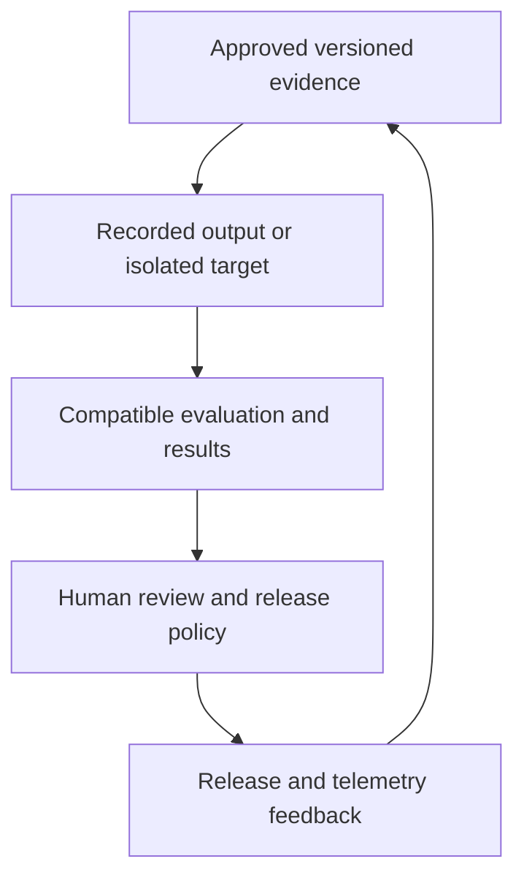

# Integrate an evaluation reference architecture

Choose the smallest architecture that supports the decision and evidence.
Recorded-response evaluation does not require a complete agent platform.
Target-generated, simulated, and production-trace workflows add different
runtime and operational dependencies.

The [Foundry overview](https://learn.microsoft.com/en-us/azure/foundry/concepts/evaluation-overview)
organizes these as choices of what to evaluate and how to run. Keep that
separation in the architecture.

## Connect the evidence-to-decision loop

This is a conceptual flow, not a diagram of provisioned resources:

Every arrow carries lineage. Dataset and policy versions, actual application/model/
tool versions, evaluator/rubric/judge settings, and evaluation/run identifiers
must be sufficient to explain the decision later.

## Separate runtime, evaluation, and policy

The application runtime produces responses and effects. Evaluation measures
those observations. The gate applies organizational policy to validated evidence.
The three functions should not silently substitute for each other.

A function definition is not an executing tool. A model's task-success claim is
not an independent effect. A completed run is not acceptance. These distinctions
prevent the most misleading "end-to-end" samples.

The [Projects SDK](https://learn.microsoft.com/en-us/python/api/overview/azure/ai-projects-readme?view=azure-python)
grounds current agent/Evals integration. Keep an explicitly versioned
compatibility boundary rather than mixing legacy thread/run APIs with current
versioned agents.

## Select infrastructure by workflow

| Workflow | Required architecture decision |
|---|---|
| Offline fixture | Local Python, versioned fixtures/policy, result artifacts |
| Recorded cloud outputs | Authorized Foundry project, judge/evaluator setup, approved data/results |
| Model/agent target | Verified deployment version, isolated tools, compatible invocation |
| Production traces | Emitted telemetry, connected Application Insights, access and retention |
| Continuous rules | Operational identity, sampling, budgets, incident ownership |

Follow [evaluation permissions](https://learn.microsoft.com/en-us/azure/foundry/observability/how-to/evaluation-permissions)
and [network requirements](https://learn.microsoft.com/en-us/azure/foundry/concepts/evaluation-virtual-network)
for the chosen rows. Do not add Cosmos DB, Search, or a landing zone merely to
score recorded data. Their need is an application architecture decision.

## Understand the implementation boundary

| Component | Repository readiness |
|---|---|
| Fixture tools, deterministic checks, normalized report, gate | Implemented in the [Contoso sample](../../samples/contoso-evaluation/README.md) with local tests |
| Current recorded-output cloud integration | Optional sample path; dependency and live-validation status documented separately |
| Production support agent and business services | Not implemented |
| Azure deployment and telemetry wiring | Conceptual guidance; no claim of provisioned or validated infrastructure |
| CI and Office publishing | Repository workflows and scripts; generated files require visual/domain acceptance |

This replaces the old claim that a partial companion was a deployable production
architecture. The preserved implementation under `archive/` is not the maintained
sample.

## Design for failed evidence

Preserve run identifiers before polling, retrieve all [result pages](https://learn.microsoft.com/en-us/azure/foundry/observability/how-to/cloud-evaluation-results),
and reject unknown attribution, missing criteria, and invalid counts. Distinguish
a candidate failure from an evaluation service failure.

Retain audit evidence under an approved policy rather than deleting cloud objects
after printing output. Protect sensitive traces separately from curated cases.
The [monitoring workflow](https://learn.microsoft.com/en-us/azure/foundry/observability/how-to/how-to-monitor-agents-dashboard)
requires real connected telemetry, not just a workspace-shaped box in a diagram.

## Architecture acceptance checklist

- The unit, source, and decision are explicit.
- Runtime effects are isolated and independently observed.
- Required evaluator coverage and actual candidate provenance are enforced.
- Caller, project, and runtime identities have separately justified access.
- Dataset/evaluator/judge/policy lineage and retention are documented.
- Retry, cancellation, budget, and evidence-failure behavior are deliberate.
- The implementation table matches what is actually tested and provisioned.

Use [operations](../operations/operations.md) for the runbook and
[target deployment](../../platform/deployment/deployment.md) for platform decisions.
