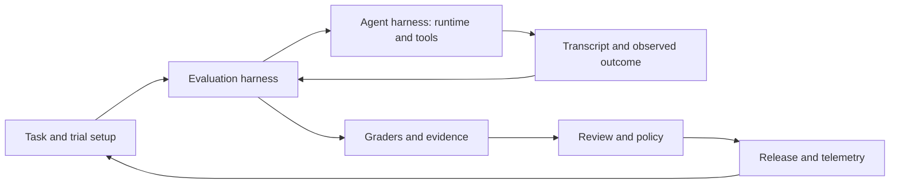

# Choose the minimum architecture

- Recorded evidence does not need a full agent platform
- Target invocation adds runtime dependencies
- Traces add telemetry/access
- Continuous rules add operational ownership

# Evidence-to-decision loop

::: notes
Conceptual flow only; no claim that Azure resources are provisioned. The agent
harness lets the model act; the evaluation harness sets up trials, captures and
grades evidence. Recorded-response evaluation need not invoke an agent harness.
M01 methodology: https://www.anthropic.com/research/demystifying-evals-for-ai-agents
:::

# Separate responsibilities

- Runtime produces responses/effects
- Evaluation harness runs trials and records evidence
- Evaluators measure observations
- Gate applies acceptance policy
- Humans own exceptions and risk

# Choose an implementation, not a blended API

- Projects SDK Evals and versioned agents
- Agent Framework local and Foundry integration
- Pin language/package generation independently
- Neither integration is the offline fixture

::: notes
Agent Framework API guidance: https://learn.microsoft.com/en-us/agent-framework/agents/evaluation
Use the language-specific package version and validate its contracts. This
optional path does not change Foundry service behavior.
:::

# Carry lineage through every step

- Data and policy versions
- Actual target/model/tool versions
- Evaluator/rubric/judge settings
- Run IDs and retained evidence

# Secure the actual workflow

- Caller, project, runtime identities
- Required model/resource scopes
- Approved trace access
- Correct network route

# Know what is implemented

- Local fixture tools and gate
- Optional recorded-output cloud path
- Publishing and local CI
- Production agent/infrastructure: not supplied

# Architecture review questions

- Can missing evidence ever pass?
- Are tool effects isolated and verified?
- Can the decision be reconstructed?
- Is live validation status explicit?

# Grounding and next path

[Overview](https://learn.microsoft.com/en-us/azure/foundry/concepts/evaluation-overview)

[Permissions](https://learn.microsoft.com/en-us/azure/foundry/observability/how-to/evaluation-permissions)

[Networking](https://learn.microsoft.com/en-us/azure/foundry/concepts/evaluation-virtual-network)

Next: P01 targets and E09 operations.
